# Multi-Tenant, Multi-Product GCP Platform

Infrastructure design and automation to host **15–20 products** for **200+ customers** across **4 environments** (`dev`, `stage`, `uat`, `prod`) on Google Cloud. Products run on **GKE**, **Cloud Run** or **Managed Instance Groups**. Customers can run different product versions with their own customizations, and data can be shared only between a customer's own environments.

> **Core idea:** a new customer, product version or customization is a **YAML change**, not new code.
> One file, `config/tenants/<customer>/<env>/<product>.yaml`, drives both Terraform (Cloud Run, MIG, identities, network, data access) and Argo CD (GKE via Helm).

## Deliverables map

| # | Assignment deliverable | Where |
|---|---|---|
| 1 | Architecture design: 4 envs, multi-product/multi-customer, version divergence, data sharing | [`docs/architecture.md`](docs/architecture.md) |
| 2 | Three architecture diagrams: Cloud Run, GKE, Instance Groups | [`docs/diagrams/cloud-run.svg`](docs/diagrams/cloud-run.svg), [`gke.svg`](docs/diagrams/gke.svg), [`mig.svg`](docs/diagrams/mig.svg) (+ [overview](docs/diagrams/overview.svg), [data sharing](docs/diagrams/data-sharing.svg); Mermaid sources in `docs/diagrams/src`) |
| 3 | Terraform for infrastructure automation | [`terraform/`](terraform): 8 modules, 7 layered stacks |
| 4 | Helm charts for GKE | [`helm/charts/product-service`](helm/charts/product-service), [`helm/charts/tenant-namespace`](helm/charts/tenant-namespace), values layers in [`helm/values`](helm/values), Argo CD in [`gitops/`](gitops) |
| 5 | Public repository with docs and code | this repository |
| – | AI prompts log | [`PROMPTS_LOG.md`](PROMPTS_LOG.md) |

## Architecture at a glance



| Concern | Decision |
|---|---|
| Hierarchy | `fldr-tenants/fldr-<customer>/` → `mtp-<customer>-{dev,stage,uat,prod}` + `mtp-<customer>-data`. Environment policy comes from an `env` **tag** plus conditional org policies. |
| Multi-product | All products of a customer share that customer's env project. Each product gets its own service account. |
| Network | Shared VPC host per env. Each customer has the same `/22` slot in every env, and firewalls allow intra-customer traffic only. |
| GKE | **Pooled** sharded clusters per env (namespace per customer) or a **dedicated** cluster per customer-env, chosen per env in `tenant.yaml` |
| Cloud Run / MIG | In the customer project, behind one global external ALB plus Cloud Armor per customer-env |
| Version divergence | Version pin per customer-env-product file, an N-2 support window in the product catalog, customer patch builds (`2.9.1-globex.2`), and a 4-layer Helm values ladder |
| Data sharing | Per-customer data project (`raw_prod`, `masked`, `shared_reference`) with IAM generated from `tenant.yaml`. A **VPC-SC perimeter and CMEK key ring per customer** prevent cross-customer movement. |
| Shared infra | GitHub/Bitbucket runners and Ansible runners (prod and non-prod pools), WIF instead of keys, Artifact Registry, Argo CD management cluster, central audit logs |

## Repository layout

```
config/                         single source of truth (data, not code)
  platform.yaml                 org, envs, IP supernets, pooled GKE shards, CI settings
  catalog/products.yaml         products, runtime, supported versions (N-2)
  tenants/<customer>/
    tenant.yaml                 tier per env, subnet slot, budgets, data-sharing rules
    <env>/<product>.yaml        release pin + customer overrides  ← the deployable unit
terraform/
  modules/                      tenant-project, tenant-subnet, gke-cluster, cloud-run-service,
                                mig-service, tenant-ingress, vpc-sc-perimeter, runner-pool
  stacks/0-bootstrap … 6-tenant-env   layered roots; tenant stacks keep one state per customer-env
helm/
  charts/product-service        generic chart for every GKE product
  charts/tenant-namespace       namespace, quota, limits, default-deny NetworkPolicy, RBAC
  values/{products,env}/        value layers 2 and 3 (layer 4 = the release file)
gitops/argocd/                  ApplicationSets (products, tenant namespaces) + AppProjects
gitops/platform/gateway.yaml    shared Gateway per cluster
ansible/, packer/               golden images for MIG products, day-2 config via IAP
tools/validate_config.py        CI gate: IP slots, versions, clusters, data-sharing rules
tools/changed_tenants.py        git diff → minimal Terraform matrix (blast radius = 1 customer-env)
.github/workflows/, bitbucket-pipelines.yml   CI/CD for both supported platforms
```

## How a change flows

```
PR edits config/tenants/acme/uat/orders.yaml  (version: 3.1.4 → 3.2.0)
  ├─ ci: validate_config.py · terraform fmt/validate/tflint/checkov · helm lint/template · kubeconform
  ├─ plan: only tenants/acme/uat (changed_tenants.py)
  └─ merge → Argo CD syncs Application "acme-uat-orders" → Helm upgrade in namespace acme
```

Version divergence in the sample data:

| Product | acme dev | acme prod | globex prod |
|---|---|---|---|
| orders (GKE) | 3.2.0 (pooled) | 3.1.4 (**dedicated** cluster) | 2.9.1-globex.2 (customer patch build) |
| billing (GKE) | – | 5.1.0 | 5.0.3 |
| notify (Cloud Run) | 1.9.0 | 1.8.0 + **10% canary on 1.9.0** | – |
| reports (Cloud Run) | – | – | 4.1.0 |
| legacy-erp (MIG) | – | 7.3.0 | – |

## Deploying

Placeholders to replace first: `org_id`, `billing_account`, `github_org` and `bitbucket_*` in `config/platform.yaml`, and the domain `example.com`.

```bash
# 0. once, as org admin (local state, then migrate into the bucket it creates)
cd terraform/stacks/0-bootstrap && terraform init && terraform apply

# 1-4. platform layers, in order (CI does this with the tf-prod identity)
for s in 1-org 2-networking 3-platform 4-gke-fleet; do
  terraform -chdir=terraform/stacks/$s init -backend-config="bucket=mtp-tfstate" -backend-config="prefix=$s"
  terraform -chdir=terraform/stacks/$s apply -var terraform_sa=... -var billing_project=mtp-seed -var state_bucket=mtp-tfstate
done

# 5-6. per customer, then per customer x env (CI runs these as a matrix)
terraform -chdir=terraform/stacks/5-tenant-base init -backend-config="bucket=mtp-tfstate" -backend-config="prefix=tenants/acme/base"
terraform -chdir=terraform/stacks/5-tenant-base apply -var customer=acme ...
terraform -chdir=terraform/stacks/6-tenant-env init -backend-config="bucket=mtp-tfstate" -backend-config="prefix=tenants/acme/prod"
terraform -chdir=terraform/stacks/6-tenant-env apply -var customer=acme -var env=prod ...

# GKE workloads: install Argo CD on mgmt-argocd, then
kubectl apply -f gitops/argocd/
```

## Validating locally

```bash
pip install pyyaml && python tools/validate_config.py        # config gate
terraform fmt -recursive terraform                             # formatting
for d in terraform/modules/* terraform/stacks/*; do terraform -chdir=$d init -backend=false && terraform -chdir=$d validate; done
helm lint helm/charts/product-service -f helm/charts/product-service/ci/acme-prod-orders-values.yaml
helm template orders helm/charts/product-service -n globex \
  -f helm/values/products/orders.yaml -f helm/values/env/prod.yaml -f config/tenants/globex/prod/orders.yaml
```

## Scope and assumptions

* This is a reference implementation for review. It hasn't been applied to a live organization, and IDs, domains and repository URLs are placeholders.
* Two sample customers (Acme: dedicated prod GKE, raw-data opt-in for UAT; Globex: fully pooled, customer patch build) and five sample products cover every runtime and tenancy variant. Scaling to 200 customers and 20 products is a matter of adding files.
* Application datastores (Cloud SQL instances and so on) are product-specific and left to each product's own module. The platform provides the network (PSA), identity, CMEK and perimeter they plug into.
* Region `asia-south1`, with locations restricted to the India regions. Both are configurable in `platform.yaml`.
