# Stage 2 – Platform architecture and diagrams

> **Status:** Proposed baseline (Stage 2), **revised after the Stage 2 architecture review** (2026-11-22).
> Nothing in this document has been deployed or tested. Review findings and their IDs (A1–A7, K1–K17) are in
> [`documentation/stage-2-architecture-review.md`](../documentation/stage-2-architecture-review.md); every change is listed in §8 and in [`CHANGELOG.md`](../CHANGELOG.md).
> Capacity numbers come from [`documentation/capacity-model.md`](../documentation/capacity-model.md) (revision 2).
> **Final reconciliation (2026-11-22):** the database engine is now **Cloud SQL for MySQL 8.4** ([`database-architecture-mysql.md`](../documentation/database-architecture-mysql.md), ADR-011) and identities follow the hybrid groups model ([`identity-and-groups-model.md`](../documentation/identity-and-groups-model.md), ADR-009 rev. 2). Review IDs M1–M8, G1–G5, C1–C3.
> Unresolved items are tracked in [`documentation/assumptions-and-open-questions.md`](../documentation/assumptions-and-open-questions.md).

## How to read this document

Every important statement is tagged so a reviewer can tell facts from proposals:

| Tag | Meaning |
|---|---|
| **[C]** | Confirmed requirement – stated in the original assignment |
| **[A]** | Assumption – made because the assignment does not say; needs company confirmation |
| **[R]** | Recommendation – the design choice proposed here; alternatives are in the ADRs |
| **[Q]** | Open question – must be answered by the company before implementation |

All diagrams are Mermaid sources in [`diagrams/`](../diagrams/) and are embedded below so GitHub renders them inline.
Run `python3 scripts/embed_diagrams.py` after editing a `.mmd` file to refresh this document.

---

## 0. Naming conventions [R]

Consistent names are what make thousands of deployments operable (800 to 40,000 depending on adoption – see the capacity model): a name tells you the customer, product, environment and tier without opening a console.

| Thing | Pattern | Example |
|---|---|---|
| Customer slug | `^[a-z][a-z0-9]{2,9}$` – 3–10 chars, no hyphens (K18) | `abc`, `xyz` |
| Product slug | `^[a-z][a-z0-9]{1,10}$` – 2–11 chars, no hyphens (K18) | `payroll`, `crm` |
| Environment | `dev`, `stg`, `uat`, `prd` | `uat` |
| Environment tier (`env_tier`) | `prd`, `nonprd` | `nonprd` |
| Isolation tier (`isolation_tier`) | `standard`, `enhanced`, `dedicated` | `standard` |
| Region code | short code | `as1` = asia-south1, `as2` = asia-south2 **[A4]** |
| Tenant project | `t-<cust>-<tier>` (+ random suffix for the real ID) | `t-abc-prd` (ID `t-abc-prd-x7k2`) |
| Platform project | `plt-<service>-<env_tier>[-<nn>]` | `plt-gke-prd`, `plt-sql-nonprd-01`, `plt-ingress-prd` |
| Product project (Shared/Cohort products only) | `p-<product>-<env_tier>` | `p-notify-prd` |
| Shared project | `shr-<service>[-<env_tier>]` | `shr-build`, `shr-artifacts`, `shr-cicd-prd` |
| Terraform state bucket | `tfstate-<org|nonprd|prd>` (in `bootstrap-seed`) | `tfstate-prd` |
| Network host project | `net-host-<tier>` | `net-host-prd` |
| GKE cluster (one per environment, `nn` = cell) | `gke-<env>-<region>-<nn>` | `gke-dev-as1-01`, `gke-prd-as1-02` |
| Namespace / Helm release | Dedicated `<cust>-<product>-<env>`; Shared `shr-<product>-<env>`; Cohort `coh-<product>-<cohort>-<env>` | `abc-payroll-uat`, `coh-ledger-v4-prd` |
| Kubernetes SA | `<product>` (inside the namespace) | `payroll` |
| Google SA (workload) – **includes the customer** because the MySQL IAM username is the SA's local part (M1) | `<cust>-<product>-<env>@t-<cust>-<tier>`; migration SA adds `-mig` | `abc-payroll-uat@t-abc-nonprd`, `abc-payroll-prd-mig@t-abc-prd` |
| MySQL account (IAM) | SA local part (≤ 32 chars) | `abc-payroll-prd` |
| MySQL role | `r_<cust>_<product>_<app|ddl|ro>` | `r_abc_payroll_app` |
| Cloud Run service | `<product>-<env>` in the tenant project | `crm-dev` in `t-abc-nonprd` |
| MIG / instance template | `mig-<product>-<env>` / `it-<product>-<env>-<version>` | `mig-ledger-prd`, `it-ledger-prd-4-2-1` |
| Cloud SQL pooled instance | prod: `sql-prd-<product or group>-<nn>`; non-prod: `sql-<env>-<nn>` | `sql-prd-payroll-01`, `sql-prd-grp1-01`, `sql-uat-01` |
| Group | `grp-<hum|pl|wl>-<purpose>[-<env_tier>][-<scope>]` | `grp-wl-sqlconn-prd-01`, `grp-hum-cust-abc-support-prd`, `grp-pl-prd-deployers` |
| Database | `<cust>_<product>` | `abc_payroll` |
| Bucket | `<cust>-<product>-<env>-<purpose>` (+ suffix) | `abc-payroll-prd-data` |
| Secret | `<product>-<env>-<name>` in the tenant project | `payroll-prd-smtp-password` |
| KMS key ring / key | `kr-<cust>-<tier>-<region>` / `<product>-<env>` | `kr-abc-prd-as1` / `payroll-prd` |
| Hostname | prod `<cust>.<product>.example.com`; non-prod `<cust>-<env>.<product>.nonprod.example.com` | `abc-uat.crm.nonprod.example.com` |
| Labels on everything | `tenant`, `product`, `env`, `env_tier`, `isolation_tier`, `deployment_model`, `cost_center` | `tenant=abc` |

`example.com` is a placeholder domain **[A11]**. In patterns, `<tier>` (e.g. `t-<cust>-<tier>`) means `env_tier`. Stage 2 used a single `tier` label for two meanings; the review split it (K2).

---

## 1. Overall GCP platform architecture

### 1.1 Resource hierarchy

```mermaid
%% 01 - GCP resource hierarchy (environment-first)
%% Status: PROPOSED baseline, revised in Stage 2 review (A1, A5, A7, K2, K16); Stage 8 K27 (plt-obs-<tier>-NN).
%% Project IDs get a random suffix in reality, e.g. t-abc-prd-x7k2. NN = shard number (01, 02 ...).
flowchart TB
  ORG["Organization: example.com<br/>org policies: no SA keys, no default network,<br/>allowed regions, uniform bucket access, OS Login"]

  ORG --> FB["fldr-bootstrap"]
  ORG --> FS["fldr-shared"]
  ORG --> FN["fldr-network"]
  ORG --> FP["fldr-platform"]
  ORG --> FT["fldr-tenants"]

  FB --> P_SEED["bootstrap-seed<br/>state buckets: tfstate-org, tfstate-nonprd, tfstate-prd<br/>(separate IAM per tier)<br/>WIF pool for GitHub OIDC"]

  FS --> P_BLD["shr-build<br/>build runners, builder SA,<br/>signing / attestations"]
  FS --> P_ART["shr-artifacts<br/>Artifact Registry: release (build-only write),<br/>snapshot (Dev only)"]
  FS --> P_CIN["shr-cicd-nonprd<br/>runner pool + deploy-nonprd"]
  FS --> P_CIP["shr-cicd-prd<br/>runner pool + deploy-prd"]
  FS --> P_SEC["shr-security<br/>audit log bucket (locked), SCC exports"]

  FN --> P_NHP["net-host-prd<br/>Shared VPC host: vpc-prd"]
  FN --> P_NHN["net-host-nonprd<br/>Shared VPC host: vpc-nonprd"]

  FP --> FPP["prd"]
  FP --> FPN["nonprd"]
  FPP --> P_GKEP["plt-gke-prd<br/>gke-prd-as1-01 (+ cells -02 ...)<br/>only platform cells in this project"]
  FPP --> P_SQLP["plt-sql-prd-NN<br/>prod pools per product group / product<br/>e.g. sql-prd-payroll-01, sql-prd-crm-01"]
  FPP --> P_INGP["plt-ingress-prd<br/>global external ALBs + Cloud Armor<br/>(Cloud Run and MIG products)"]
  FPP --> P_PRODP["p-product-prd<br/>only for Shared / Cohort products"]
  FPP --> P_OBP["plt-obs-prd-NN<br/>metrics scope, SLOs, alerts (K27)<br/>sharded at ~375 projects"]
  FPN --> P_GKEN["plt-gke-nonprd<br/>gke-dev-as1-01, gke-stg-as1-01,<br/>gke-uat-as1-01 (+ cells)"]
  FPN --> P_SQLN["plt-sql-nonprd-NN<br/>sql-dev-NN, sql-stg-NN, sql-uat-NN"]
  FPN --> P_INGN["plt-ingress-nonprd"]
  FPN --> P_PRODN["p-product-nonprd<br/>only for Shared / Cohort products"]
  FPN --> P_OBN["plt-obs-nonprd-NN<br/>metrics scope (K27)"]

  FT --> FTP["prd<br/>strict prod policies + prod access groups"]
  FT --> FTN["nonprd"]
  FTP --> T_ABCP["t-abc-prd<br/>tag isolation_tier=standard"]
  FTP --> T_XYZP["t-xyz-prd<br/>tag isolation_tier=standard"]
  FTP --> T_BIGP["t-bigco-prd<br/>tag isolation_tier=dedicated<br/>own GKE cluster + own Cloud SQL"]
  FTN --> T_ABCN["t-abc-nonprd<br/>Dev + Stage + UAT"]
  FTN --> T_XYZN["t-xyz-nonprd<br/>Dev + Stage + UAT"]
  FTN --> T_BIGN["t-bigco-nonprd<br/>uses shared non-prod tiers by default (Q18)"]

  P_NHP -. "subnets shared with service projects in" .-> FPP
  P_NHP -. "subnets shared with service projects in" .-> FTP
  P_NHN -. "subnets shared with service projects in" .-> FPN
  P_NHN -. "subnets shared with service projects in" .-> FTN

  classDef prd fill:#fde2e1,stroke:#c0392b,color:#000
  classDef nonprd fill:#e1ecfd,stroke:#2c6fbb,color:#000
  classDef shared fill:#eeeeee,stroke:#555,color:#000
  class FPP,FTP,P_GKEP,P_SQLP,P_INGP,P_PRODP,T_ABCP,T_XYZP,T_BIGP,P_NHP,P_CIP,P_OBP prd
  class FPN,FTN,P_GKEN,P_SQLN,P_INGN,P_PRODN,T_ABCN,T_XYZN,T_BIGN,P_NHN,P_CIN,P_OBN nonprd
  class FB,FS,FN,FP,FT,P_SEED,P_ART,P_SEC,P_BLD shared
```

*Source: [`diagrams/01-resource-hierarchy.mmd`](../diagrams/01-resource-hierarchy.mmd)*

**Read it top-down:**

1. **Organization** holds the guardrails that apply everywhere: no service-account keys, no default networks, allowed regions only, uniform bucket-level access, OS Login required **[R]**.
2. **fldr-bootstrap** holds the one project created by hand (`bootstrap-seed`): Terraform state buckets and the Workload Identity Federation pool that lets CI authenticate without keys.
3. **fldr-shared** holds services used by every customer: the build pipeline (`shr-build`, the only writer of release artifacts), Artifact Registry, CI/CD deploy runners (one pool per tier), observability (metrics scopes per tier, sharded at ~375 projects) and security logging. `bootstrap-seed` keeps **separate Terraform state buckets per tier** (review A5).
4. **fldr-network** holds the two Shared VPC host projects. Production and non-production are separate VPCs with no peering between them.
5. **fldr-platform** holds the expensive pooled runtimes, split by tier: GKE clusters (**one per environment**, ADR-008), pooled Cloud SQL instances in sharded pool projects, the ingress load balancers for Cloud Run and MIG products, and product projects `p-<product>-<env_tier>` for products using the Shared or Cohort model (ADR-006).
6. **fldr-tenants** holds two projects per customer **[R, ADR-007]**, sorted by environment first **[R, ADR-002]**. Dedicated-tier customers (example `t-bigco-prd`) stay in the same `prd` folder so they inherit every production policy; their isolation tier is a tag (`isolation_tier=dedicated`), not a separate folder.

### 1.2 Platform architecture

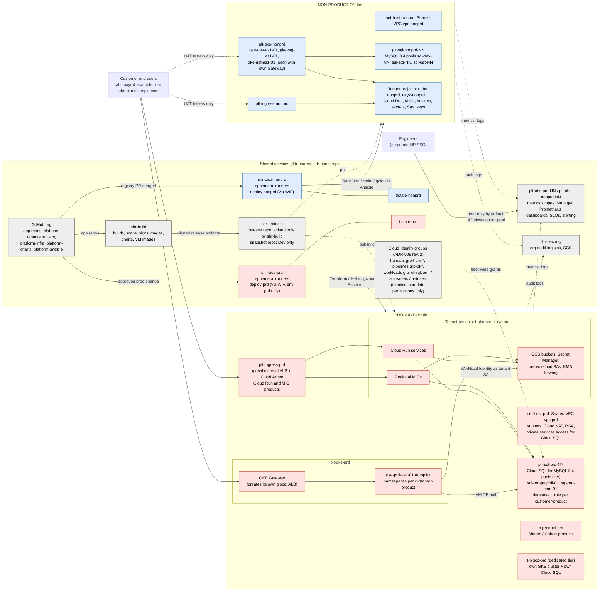

*Source: [`diagrams/02-platform-architecture.mmd`](../diagrams/02-platform-architecture.mmd)*

### 1.3 Component responsibilities

| Component | Purpose | Shared or customer-specific | Owner |
|---|---|---|---|
| `bootstrap-seed` | Terraform state buckets `tfstate-org`, `tfstate-nonprd`, `tfstate-prd` (GCS, versioned, one state file per stack, separate IAM per tier), WIF pool for GitHub OIDC | Shared | Platform team |
| `shr-build` | Builds, scans and signs images, Helm charts and VM images; the only identity allowed to write release artifacts (ADR-010) | Shared | Platform team |
| `shr-artifacts` | Artifact Registry: `release` repository (written only by `shr-build`) and `snapshot` repository (Dev only); Artifact Analysis vulnerability scanning; read access via group `grp-wl-ar-readers` | Shared (read-only to runtimes) | Platform team |
| `shr-cicd-nonprd` / `shr-cicd-prd` | Ephemeral self-hosted runners and deployer service accounts. Separate projects so a non-prod runner can never hold prod credentials **[R]** | Shared, split by tier | Platform team |
| `plt-obs-nonprd-NN` / `plt-obs-prd-NN` (K27, Stage 8: tier projects in `fldr-platform/<tier>`, formerly `shr-obs-*`) | Cloud Monitoring metrics scopes, Managed Prometheus queries, dashboards, SLOs, alert policies, notification channels | Per tier | Platform/SRE |
| `shr-security` | Organization audit-log sink into a locked log bucket; Security Command Center findings export | Shared | Security team |
| `net-host-prd` / `net-host-nonprd` | Shared VPC networks, subnets, firewall policies, Cloud NAT, Cloud DNS, private services access for Cloud SQL | Shared, split by tier | Network/platform team |
| `plt-ingress-*` | Global external Application Load Balancers + Cloud Armor for Cloud Run and MIG products. Backend services live in tenant projects and are referenced across projects | Shared front door, per-customer backends | Platform team |
| `plt-gke-*` | GKE Autopilot clusters, one per environment and sharded into cells (shared, multi-tenant by namespace), and the GKE Gateway that fronts each cluster. Only platform cells live here (Workload Identity identity sameness) | Shared | Platform team |
| `plt-sql-<env_tier>-<nn>` | Pooled Cloud SQL for MySQL 8.4 instances, sharded across projects; one hardened database per customer-product; IAM connect permission via `grp-wl-sqlconn-<tier>-NN` groups | Shared instance, customer-specific databases | Platform team (DBA role) |
| `p-<product>-<env_tier>` | Cloud Run / MIG deployments and data of Shared or Cohort products | Product-specific, multi-customer | Product team + platform |
| Cloud Identity / Workspace groups `grp-hum-*`, `grp-pl-*`, `grp-wl-*` | Groups aggregate identical, non-data permissions (SQL connect, artifact read, subnet use, human roles); individual SAs keep tenant data access (ADR-009 rev. 2, identity-and-groups model) | Shared | Platform team (automated from registry / IdP) |
| `t-<cust>-prd` / `t-<cust>-nonprd` | Everything the customer owns: workload service accounts, buckets, secrets, KMS keys, Cloud Run services, MIGs, backend services; dedicated Cloud SQL / GKE for the dedicated tier | Customer-specific | Created by automation; no standing human write access |
| GitHub | Application code repos, `platform-tenants` (tenant registry), `platform-infra` (Terraform), `platform-charts` (Helm), `platform-ansible` | Shared | Each repo has CODEOWNERS |
| Terraform | Creates and changes **infrastructure**: projects, IAM, networks, clusters, databases, buckets, Cloud Run service shells, MIGs | – | Platform team |
| Helm | Deploys **application releases** into GKE namespaces | – | Product teams (via pipeline) |
| Ansible | Bakes VM images (with Packer) and handles configuration of MIG VMs | – | Platform + product teams |

**[C]** The assignment requires GitHub/Bitbucket repositories and Ansible runners as shared infrastructure. GitHub is used in the examples **[A6]**; Bitbucket Pipelines also supports OIDC and self-hosted runners, so the same design applies.

---

## 2. Runtime architectures

### 2A. GKE-based product (Payroll)

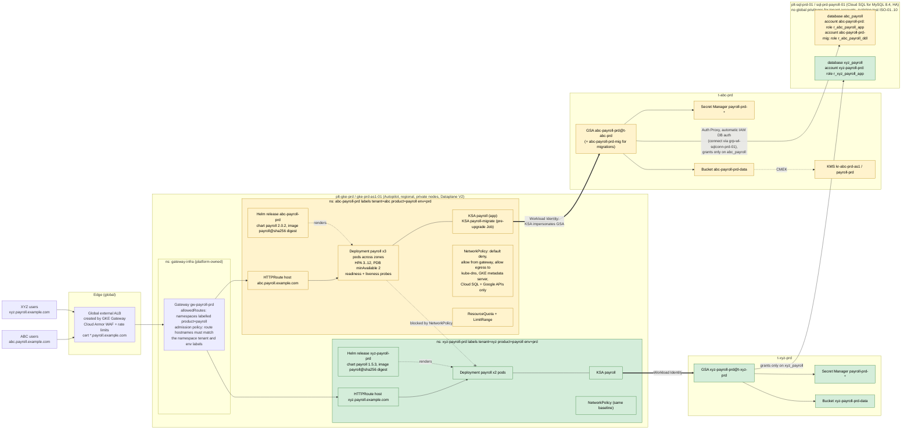

*Source: [`diagrams/03-gke-runtime.mmd`](../diagrams/03-gke-runtime.mmd)*

**How a request flows (step by step):**

1. A user of customer ABC opens `abc.payroll.example.com`. DNS points to the global external Application Load Balancer that the GKE **Gateway** `gw-payroll-prd` created.
2. Cloud Armor checks the request (WAF rules, rate limits) before it reaches the cluster.
3. The Gateway lives in the platform-owned `gateway-infra` namespace. It only accepts `HTTPRoute`s from namespaces labelled `product=payroll`, so a tenant cannot hijack another product's front door.
4. The `HTTPRoute` in `abc-payroll-prd` matches the host `abc.payroll.example.com` and sends traffic to ABC's pods only. XYZ's route matches only `xyz.payroll.example.com`.
5. ABC's pods run as Kubernetes service account `payroll`, which **impersonates** the Google service account `abc-payroll-prd@t-abc-prd` through Workload Identity. No keys exist anywhere.
6. With that identity the pod can read **only** ABC's secrets and ABC's bucket. It reaches the pooled MySQL instance through the Cloud SQL connector with automatic IAM database authentication as MySQL account `abc-payroll-prd`; the project-level connect permission comes from group `grp-wl-sqlconn-prd-01`, and inside MySQL it holds only role `r_abc_payroll_app` on `` `abc\_payroll`.* ``. Because a MySQL connection is not bound to one database, this isolation rests entirely on privileges – hence the hardening baseline and the mandatory isolation test ISO-01…10 ([database architecture](../documentation/database-architecture-mysql.md), ADR-003 rev. 3).

**How deployment works:**

1. The tenant file says `abc → payroll → prd: 2.0.2`.
2. The pipeline runs `helm upgrade --install abc-payroll-prd` with chart version `2.0.2`, the image pinned by **digest** (not a mutable tag), and values layered as *chart defaults → product prd defaults → ABC overrides → ABC prd overrides*.
3. Rolling update: new pods must pass readiness probes before old pods are removed; a PodDisruptionBudget keeps at least two pods up during node maintenance.

**Two versions in one cluster:** ABC's release (`2.0.2`) and XYZ's release (`1.5.3`) are two separate Helm releases in two separate namespaces. Upgrading one is a different command with a different release name; the other is not touched. The only shared constraint is that both versions must run on the cluster's Kubernetes version (handled by the platform's upgrade testing) and both must support the MySQL major version (8.4) of `sql-prd-payroll-01`.

**Isolation controls inside the cluster [R]:**

| Control | What it stops |
|---|---|
| Namespace per customer-product-env, created only by the platform pipeline | Name collisions; the unit for RBAC, quota and policy. Only platform cells exist in `plt-gke-*` projects, so a namespace name cannot be re-created elsewhere to inherit a tenant's Workload Identity (review F5) |
| RBAC: humans get read-only per namespace; only the deployer can write | An engineer for ABC changing XYZ's workloads |
| NetworkPolicy default-deny (Dataplane V2), applied before any workload; egress allows only kube-dns, the GKE metadata server, Cloud SQL and Google APIs | Pod-to-pod traffic between customers |
| Gateway hostname policy: HTTPRoute hostnames must equal the hostnames derived from the namespace's `tenant`/`env` labels (admission policy + registry validation) | One tenant claiming another tenant's hostname (review A6) |
| ResourceQuota + LimitRange | One customer consuming the whole cluster |
| Workload Identity per namespace | A pod reaching another customer's GCP resources |
| Policy controller (e.g. Gatekeeper/Policy Controller constraints) | Privileged pods, `hostPath`, missing labels, images not from `shr-artifacts` |
| Enhanced tier: workload separation (toleration + node selector) | Sharing nodes with other customers. Autopilot supports this; it raises the minimum pod requests, which is a cost to account for |

**Autoscaling and health:** HPA on CPU/requests per second per release; Autopilot provisions nodes automatically; readiness, liveness and startup probes on every container; Managed Service for Prometheus scrapes app metrics with `namespace` (therefore tenant) labels.

**HA and DR:** Autopilot clusters are regional, so pods spread across three zones; topology spread constraints in the chart make it explicit. DR is covered in section 6.

### 2B. Cloud Run-based product (CRM)

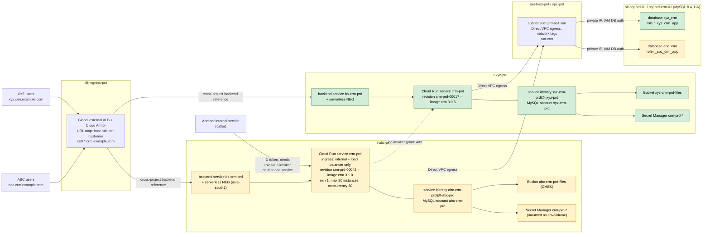

*Source: [`diagrams/04-cloudrun-runtime.mmd`](../diagrams/04-cloudrun-runtime.mmd)*

**Step by step:**

1. `abc.crm.example.com` resolves to the shared production ALB in `plt-ingress-prd`. Its URL map has one host rule per customer.
2. The host rule points to backend service `bs-crm-prd` **in ABC's tenant project** (cross-project service referencing). That backend service has a serverless NEG pointing to Cloud Run service `crm-prd` in `t-abc-prd`.
3. The Cloud Run service's ingress is `internal-and-cloud-load-balancing`, so the public `run.app` URL does not accept traffic.
4. The service runs as `abc-crm-prd@t-abc-prd`. Secrets are mounted from Secret Manager in the same project; files go to ABC's bucket.
5. Outbound traffic to Cloud SQL uses **Direct VPC egress** into the shared subnet `snet-prd-as1-run`, then IAM database authentication to `abc_crm` on `sql-prd-crm-01`.
6. Service-to-service calls use Google-signed ID tokens. A caller needs `roles/run.invoker` on that specific service; nobody has it across customers, so a cross-customer call returns 403.

**Why the service lives in the tenant project:** Cloud Run has no shared cluster to pool, so placing it in the customer's own project gives project-level IAM isolation, per-customer quotas and per-customer billing at no extra cost **[R]**.

**Versions and deployment:**

- Terraform owns the *service shell*: name, identity, ingress setting, VPC egress, min/max instances, IAM. It ignores the image field.
- The deploy step owns the *version*: deploy a new revision with no traffic and a revision tag, smoke-test the tagged URL, then shift traffic (100%, or 10% → 100% for a canary).
- ABC runs revision `crm-prd-00042` (image `3.1.0`); XYZ runs `crm-prd-00017` (image `3.0.5`). Different projects, different services: an update to one cannot touch the other.
- Rollback = move traffic back to the previous revision (seconds).

**Autoscaling:** per service: `min_instances` (1 in prod to avoid cold starts, 0 in non-prod), `max_instances` (a cap that protects the shared database), `concurrency` (requests per instance, tuned per product).

### 2C. Compute Engine MIG-based product (illustrative product "Ledger")

The assignment requires MIG support **[C]** but names no MIG product. "Ledger" is a placeholder.

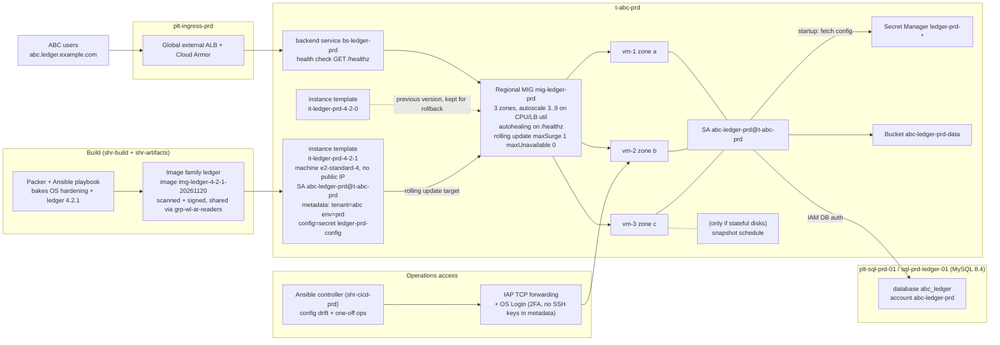

*Source: [`diagrams/05-mig-runtime.mmd`](../diagrams/05-mig-runtime.mmd)*

**Step by step:**

1. **Build once per version:** in `shr-build` (never on a deploy runner – review A5), Packer runs the product's Ansible playbook on a hardened base image and produces `img-ledger-4-2-1-<date>` in `shr-artifacts`. The image is scanned, signed and shared with tenant projects through group `grp-wl-ar-readers`. The image contains the application but **no customer data or customer config**.
2. **Per customer:** Terraform creates instance template `it-ledger-prd-4-2-1` in `t-abc-prd` with the image, machine type, no public IP, the VM service account `abc-ledger-prd@t-abc-prd` and metadata (`tenant=abc`, `env=prd`, name of the config secret).
3. **On boot:** the startup script reads its configuration from Secret Manager using the VM's own identity. Customer-specific configuration is therefore data, not a different image.
4. **Regional MIG** `mig-ledger-prd` spreads VMs across three zones, autoscales on CPU or load-balancer utilisation, and **autohealing** recreates any VM that fails `/healthz`.
5. **Load balancing:** the shared prod ALB routes `abc.ledger.example.com` to backend service `bs-ledger-prd` (cross-project), which uses the MIG as its backend. Health checks come from Google's documented ranges, allowed by the firewall policy.
6. **Upgrades:** set the MIG's template to `it-ledger-prd-4-2-1`; the rolling updater adds one new VM, waits for it to be healthy, removes one old VM (maxSurge 1, maxUnavailable 0). A canary is possible by running two templates with a target size split. Rollback = point the MIG back at `it-ledger-prd-4-2-0` (kept for that reason).
7. **Ansible after build:** used for drift correction and one-off operational tasks, run from the prod runner pool. It reaches VMs through **IAP TCP forwarding + OS Login** (no SSH keys in metadata, no public IPs, no bastion host). Inventory is built dynamically from labels (`tenant=abc,product=ledger,env=prd`), so a playbook run is scoped to one customer by default.
8. **Backup:** VMs are stateless (state is in Cloud SQL and GCS), so there is nothing to back up on the VM. If a product insists on stateful disks, the MIG uses stateful disk configuration plus a snapshot schedule **[Q: are any MIG products stateful?]**.

---

## 3. Customer onboarding and deployment workflow

### 3.1 The tenant registry (source of truth) [R] – schema v2

One file per customer in the `platform-tenants` repo. Illustrative only – the schema is finalised in the Terraform stage.
**Revised in the Stage 2 review (A7, K2, K3):** subscription-level blocks, placement **per environment**, deployment-model aware, `isolation_tier` instead of `tier`.

```yaml
# tenants/abc.yaml  (illustrative, schema v2)
tenant: abc
display_name: "ABC Ltd"
isolation_tier: standard       # standard | enhanced | dedicated
status: active                 # active | offboarding
owners: { business: "abc-account-team", technical: "grp-hum-cust-abc-support" }   # group family prefix; -prd / -nonprd groups are derived (K22)
subscriptions:                 # only the products ABC subscribes to: 1 block or 20, same schema
  payroll:                     # catalogue says: runtime gke, deployment_model dedicated
    versions:  { dev: 2.1.0, stg: 2.0.3, uat: 2.0.3, prd: 2.0.2 }
    placement:                 # written by the validator when the block is added, then stable
      dev: { gke: gke-dev-as1-01, sql: sql-dev-01 }
      stg: { gke: gke-stg-as1-01, sql: sql-stg-01 }
      uat: { gke: gke-uat-as1-01, sql: sql-uat-01 }
      prd: { gke: gke-prd-as1-01, sql: sql-prd-payroll-01 }
    config: { pay_cycle: monthly, currency: INR }   # non-secret customer config
  crm:                         # catalogue says: runtime cloudrun, deployment_model dedicated
    versions:  { dev: 3.2.0, stg: 3.1.1, uat: 3.1.1, prd: 3.1.0 }
    placement:                 # Cloud Run runs in t-abc-<env_tier>; only the DB needs placing
      dev: { sql: sql-dev-01 }
      stg: { sql: sql-stg-01 }
      uat: { sql: sql-uat-01 }
      prd: { sql: sql-prd-crm-01 }
  notify:                      # illustrative Shared product: no per-customer version
    config: { sender_domain: abc.example.com }
  ledger:                      # illustrative Cohort product: cohort per environment
    cohort: { dev: v4, stg: v4, uat: v4, prd: v3 }
```

The ABC/XYZ worked example in §4 uses only `payroll` and `crm`; `notify` and `ledger` are shown here to illustrate the Shared and Cohort schema.

Validation rules that matter for isolation: every hostname, bucket, secret, namespace and database name is **derived** from `tenant` + product + environment – the file cannot contain free-form resource names or hostnames (review A6, X6). **Schema v2.1 (K18):** slug regexes and length budget so every derived service-account ID fits Google's 30-character limit (migration SA max exactly 30) – see [`registry/naming-rules.md`](../registry/naming-rules.md) and the boundary tests in `scripts/validate_names.py`.

The product catalogue (one file per product, owned by the product team) says *how* a product runs:

```yaml
# products/payroll.yaml  (illustrative)
product: payroll
runtime: gke                   # gke | cloudrun | mig
deployment_model: dedicated    # dedicated | shared | cohort
chart: oci://asia-south1-docker.pkg.dev/<shr-artifacts>/release/charts/payroll
database: { engine: mysql, major_version: "8.4", pool_group: g1, approx_tables: 300 }   # pool_group: see capacity model
supported_versions: [1.5.x, 2.0.x, 2.1.x]
blocked_versions: [2.0.0]      # e.g. a known bad release
---
# products/ledger.yaml  (illustrative Cohort product)
product: ledger
runtime: mig
deployment_model: cohort
cohorts: { v3: 3.9.4, v4: 4.2.1 }   # cohort -> version mapping
```

### 3.2 New customer → product: request to handover

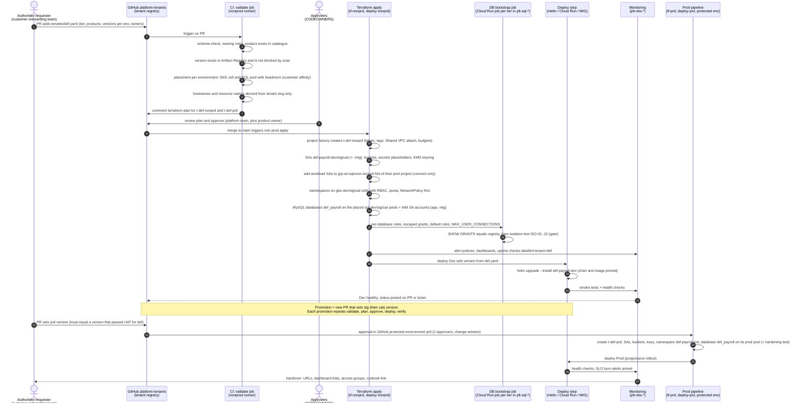

*Source: [`diagrams/06-onboarding-workflow.mmd`](../diagrams/06-onboarding-workflow.mmd)*

**Step by step:**

1. **Request:** an authorised requester opens a PR adding `tenants/def.yaml`. Who may request is controlled by CODEOWNERS and branch protection, not by a separate portal **[R, initial phase]**.
2. **Validation (automatic):** schema, naming rules (all names and hostnames derived from the tenant slug), product exists, every requested version exists in the `release` repository and is not blocked by a vulnerability policy, and **placement per environment** – the validator picks, for Dev, Stage, UAT and Prod separately, a GKE cell and a Cloud SQL pool with headroom (customer affinity first) and writes them into the file so placement never changes silently later. If nothing has headroom, validation fails with "capacity needed" and the platform team adds a pool or cell through a separate platform PR.
3. **Plan:** `terraform plan` for the new tenant stacks is posted to the PR. Reviewers see exactly what will be created.
4. **Approval:** platform team + product owner approve.
5. **Non-prod apply:** project factory creates `t-def-nonprd` (labels, tags, Shared VPC attachment, budget alert); then service accounts (added to the `grp-wl-*` groups rather than to shared project policies), buckets, secret *containers* (values are added by the owning team or generated), KMS key ring, namespaces on the placed Dev/Stage/UAT cells with RBAC/quota/NetworkPolicy created **before** any workload, Cloud SQL databases + IAM DB users on the placed pools.
6. **Database hardening and grants:** creating a database and IAM user is an API call, but `REVOKE`/`GRANT` statements need a SQL session. A **DB bootstrap job** per tier (Cloud Run job inside the VPC, identity `sqlboot-<tier>`) creates the per-database roles, grants them on the **escaped** database name to the app and migration accounts only, verifies `SHOW GRANTS` against the registry, and runs the **isolation test ISO-01…10** (database architecture §6 and §9).
7. **Monitoring:** alert policies, uptime checks and the customer dashboard are created from templates with `tenant=def`.
8. **Deploy Dev** with the pinned version, run smoke tests, post the result to the PR.
9. **Promote** Stage, then UAT, each by a PR that changes one version number – same validate → plan → approve → deploy → verify loop.
10. **Production:** the prd PR is only valid if the version has passed UAT for this customer (checked by the validator against deployment history). It runs in the GitHub `prd` environment, which requires two approvers and can enforce a change window. The prod pipeline uses a different runner pool and a different identity (`deploy-prd`).
11. **Handover:** URLs, dashboard links, the access groups that were created, and the runbook link are posted to the PR / ticket.

### 3.3 Day-2 operations: new product, upgrade, offboarding

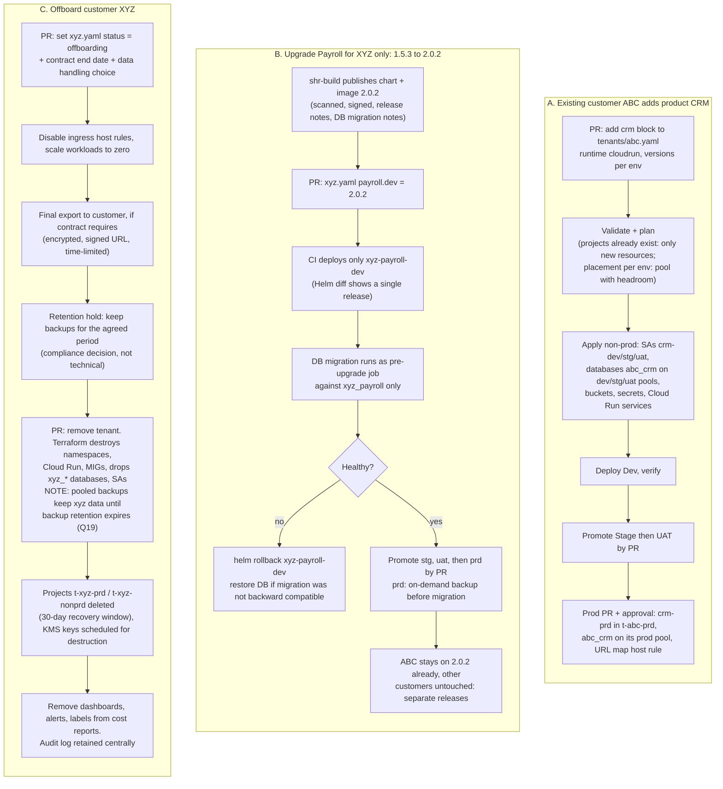

*Source: [`diagrams/07-lifecycle-operations.mmd`](../diagrams/07-lifecycle-operations.mmd)*

- **Existing customer adds a product (A):** the projects already exist, so the plan only adds product resources. CRM is Cloud Run, so the deploy step creates services in ABC's projects and adds host rules to the shared ALB.
- **Version upgrade for one customer (B):** a PR changes one number in one file. The pipeline computes which releases changed (`helm diff`) and deploys only those. Database migrations run as a Helm pre-upgrade hook against that customer's database only. Prod upgrades take an on-demand Cloud SQL backup first. If a migration is not backward compatible, rollback needs a database restore – product teams must declare this in release notes **[R]**.
- **Offboarding (C):** is deliberately two-step. First `status: offboarding` disables traffic and scales to zero while data-retention obligations are handled (final export, retention hold). Only then a second PR removes the tenant and Terraform destroys its resources. **How long backups are kept after a contract ends is a legal decision [Q11].** Note (review K14): on pooled instances, backups and PITR logs are per instance, so an offboarded customer's data remains in pool backups until their retention expires; whether that satisfies erasure obligations is **[Q19]**. Removing a single product follows the same steps for one subscription block.

---

## 4. Worked example: ABC and XYZ

### 4.1 Version matrix (illustrative)

| Customer | Product (runtime) | Dev | Stage | UAT | Prod |
|---|---|---|---|---|---|
| ABC | Payroll (GKE) | 2.1.0 | 2.0.3 | 2.0.3 | 2.0.2 |
| XYZ | Payroll (GKE) | 2.0.2 | 1.5.4 | 1.5.4 | 1.5.3 |
| ABC | CRM (Cloud Run) | 3.2.0 | 3.1.1 | 3.1.1 | 3.1.0 |
| XYZ | CRM (Cloud Run) | 3.1.1 | 3.0.5 | 3.0.5 | 3.0.5 |

XYZ is evaluating Payroll 2.0.2 in Dev while its Prod stays on 1.5.3; ABC is already on 2.0.2 in Prod. Neither affects the other.

### 4.2 Diagram

```mermaid
%% 08 - Worked example: ABC and XYZ, Payroll (GKE) and CRM (Cloud Run), all four environments
%% Versions are illustrative. Each box is owned by exactly one customer unless marked SHARED.
%% Revised in Stage 2 review: one GKE cluster per environment (ADR-008), pool project names, group IAM.
%% Final reconciliation: MySQL 8.4 pools, SA IDs include the customer (M1).
flowchart TB
  subgraph NP["NON-PROD tier"]
    direction LR
    subgraph GKEN["SHARED: plt-gke-nonprd (one cluster per environment)"]
      direction TB
      CDEV["gke-dev-as1-01<br/>abc-payroll-dev v2.1.0<br/>xyz-payroll-dev v2.0.2"]
      CSTG["gke-stg-as1-01<br/>abc-payroll-stg v2.0.3<br/>xyz-payroll-stg v1.5.4"]
      CUAT["gke-uat-as1-01<br/>abc-payroll-uat v2.0.3<br/>xyz-payroll-uat v1.5.4"]
    end
    subgraph TAN["t-abc-nonprd"]
      direction TB
      RA_N["Cloud Run<br/>crm-dev v3.2.0<br/>crm-stg v3.1.1<br/>crm-uat v3.1.1"]
      SA_AN["SAs abc-payroll-dev/stg/uat,<br/>abc-crm-dev/stg/uat (+ -mig)"]
      BK_AN["Buckets abc-payroll-ENV-data,<br/>abc-crm-ENV-files,<br/>abc-nonprd-masked-ingest"]
      SM_AN["Secrets payroll-ENV-*, crm-ENV-*<br/>KMS kr-abc-nonprd-as1"]
    end
    subgraph TXN["t-xyz-nonprd"]
      direction TB
      RX_N["Cloud Run<br/>crm-dev v3.1.1<br/>crm-stg v3.0.5<br/>crm-uat v3.0.5"]
      SA_XN["SAs xyz-payroll-dev/stg/uat,<br/>xyz-crm-dev/stg/uat (+ -mig)"]
      BK_XN["Buckets xyz-PRODUCT-ENV-*,<br/>xyz-nonprd-masked-ingest"]
      SM_XN["Secrets + KMS kr-xyz-nonprd-as1"]
    end
    subgraph SQLN["SHARED: plt-sql-nonprd-01 (MySQL 8.4)"]
      direction TB
      DEV["sql-dev-01 (zonal)<br/>abc_payroll, abc_crm,<br/>xyz_payroll, xyz_crm"]
      STG["sql-stg-01 (zonal)<br/>same four databases"]
      UAT["sql-uat-01 (HA, Q15)<br/>same four databases"]
    end
  end

  subgraph PR["PROD tier"]
    direction LR
    subgraph GKEP["SHARED: plt-gke-prd / gke-prd-as1-01"]
      direction TB
      PA["abc-payroll-prd  v2.0.2"]
      PX["xyz-payroll-prd  v1.5.3"]
    end
    subgraph TAP["t-abc-prd"]
      direction TB
      RA_P["Cloud Run crm-prd v3.1.0"]
      SA_AP["SAs abc-payroll-prd, abc-crm-prd (+ -mig),<br/>masker-prd"]
      BK_AP["Buckets abc-payroll-prd-data,<br/>abc-crm-prd-files, abc-prd-exports"]
      SM_AP["Secrets + KMS kr-abc-prd-as1"]
    end
    subgraph TXP["t-xyz-prd"]
      direction TB
      RX_P["Cloud Run crm-prd v3.0.5"]
      SA_XP["SAs xyz-payroll-prd, xyz-crm-prd (+ -mig),<br/>masker-prd"]
      BK_XP["Buckets xyz-payroll-prd-data,<br/>xyz-crm-prd-files, xyz-prd-exports"]
      SM_XP["Secrets + KMS kr-xyz-prd-as1"]
    end
    subgraph SQLP["SHARED: plt-sql-prd-01 (MySQL 8.4)"]
      direction TB
      PPAY["sql-prd-payroll-01 (HA)<br/>abc_payroll, xyz_payroll"]
      PCRM["sql-prd-crm-01 (HA)<br/>abc_crm, xyz_crm"]
    end
  end

  CDEV -- "Workload Identity (ABC ns)" --> SA_AN
  CDEV -- "Workload Identity (XYZ ns)" --> SA_XN
  RA_N --- SA_AN
  RX_N --- SA_XN
  SA_AN -- "grants on abc_* only" --> SQLN
  SA_XN -- "grants on xyz_* only" --> SQLN
  PA -- "Workload Identity" --> SA_AP
  PX -- "Workload Identity" --> SA_XP
  RA_P --- SA_AP
  RX_P --- SA_XP
  SA_AP -- "abc_* only" --> SQLP
  SA_XP -- "xyz_* only" --> SQLP

  SA_AP == "masker-prd: one-way,<br/>write-only to masked-ingest" ==> BK_AN
  SA_XP == "masker-prd: one-way" ==> BK_XN

  SA_AN -. "DENIED: no IAM on t-xyz-*" .-x BK_XN
  SA_AN -. "DENIED: non-prod has no prod access" .-x BK_AP

  classDef abc fill:#fff3cd,stroke:#b8860b,color:#000
  classDef xyz fill:#d4edda,stroke:#2e7d32,color:#000
  classDef shared fill:#eeeeee,stroke:#555,color:#000
  class RA_N,SA_AN,BK_AN,SM_AN,PA,RA_P,SA_AP,BK_AP,SM_AP abc
  class RX_N,SA_XN,BK_XN,SM_XN,PX,RX_P,SA_XP,BK_XP,SM_XP xyz
  class DEV,STG,UAT,PPAY,PCRM,CDEV,CSTG,CUAT shared
```

*Source: [`diagrams/08-abc-xyz-example.mmd`](../diagrams/08-abc-xyz-example.mmd)*

### 4.3 Resource mapping (all four environments)

| Cust | Product | Env | Project | Compute | Workload identity | Database (instance / db) | Bucket | Secrets / key |
|---|---|---|---|---|---|---|---|---|
| ABC | Payroll | dev | `t-abc-nonprd` | ns `abc-payroll-dev` on `gke-dev-as1-01` | `abc-payroll-dev@t-abc-nonprd` | `sql-dev-01` / `abc_payroll` | `abc-payroll-dev-data` | `payroll-dev-*` / `kr-abc-nonprd-as1` |
| ABC | Payroll | stg | `t-abc-nonprd` | ns `abc-payroll-stg` on `gke-stg-as1-01` | `abc-payroll-stg@t-abc-nonprd` | `sql-stg-01` / `abc_payroll` | `abc-payroll-stg-data` | `payroll-stg-*` |
| ABC | Payroll | uat | `t-abc-nonprd` | ns `abc-payroll-uat` on `gke-uat-as1-01` | `abc-payroll-uat@t-abc-nonprd` | `sql-uat-01` / `abc_payroll` | `abc-payroll-uat-data` | `payroll-uat-*` |
| ABC | Payroll | prd | `t-abc-prd` | ns `abc-payroll-prd` on `gke-prd-as1-01` | `abc-payroll-prd@t-abc-prd` | `sql-prd-payroll-01` / `abc_payroll` | `abc-payroll-prd-data` | `payroll-prd-*` / `kr-abc-prd-as1` |
| ABC | CRM | dev | `t-abc-nonprd` | Cloud Run `crm-dev` | `abc-crm-dev@t-abc-nonprd` | `sql-dev-01` / `abc_crm` | `abc-crm-dev-files` | `crm-dev-*` |
| ABC | CRM | stg | `t-abc-nonprd` | Cloud Run `crm-stg` | `abc-crm-stg@t-abc-nonprd` | `sql-stg-01` / `abc_crm` | `abc-crm-stg-files` | `crm-stg-*` |
| ABC | CRM | uat | `t-abc-nonprd` | Cloud Run `crm-uat` | `abc-crm-uat@t-abc-nonprd` | `sql-uat-01` / `abc_crm` | `abc-crm-uat-files` | `crm-uat-*` |
| ABC | CRM | prd | `t-abc-prd` | Cloud Run `crm-prd` | `abc-crm-prd@t-abc-prd` | `sql-prd-crm-01` / `abc_crm` | `abc-crm-prd-files` | `crm-prd-*` |
| XYZ | Payroll | dev | `t-xyz-nonprd` | ns `xyz-payroll-dev` on `gke-dev-as1-01` | `xyz-payroll-dev@t-xyz-nonprd` | `sql-dev-01` / `xyz_payroll` | `xyz-payroll-dev-data` | `payroll-dev-*` / `kr-xyz-nonprd-as1` |
| XYZ | Payroll | stg | `t-xyz-nonprd` | ns `xyz-payroll-stg` on `gke-stg-as1-01` | `xyz-payroll-stg@t-xyz-nonprd` | `sql-stg-01` / `xyz_payroll` | `xyz-payroll-stg-data` | `payroll-stg-*` |
| XYZ | Payroll | uat | `t-xyz-nonprd` | ns `xyz-payroll-uat` on `gke-uat-as1-01` | `xyz-payroll-uat@t-xyz-nonprd` | `sql-uat-01` / `xyz_payroll` | `xyz-payroll-uat-data` | `payroll-uat-*` |
| XYZ | Payroll | prd | `t-xyz-prd` | ns `xyz-payroll-prd` on `gke-prd-as1-01` | `xyz-payroll-prd@t-xyz-prd` | `sql-prd-payroll-01` / `xyz_payroll` | `xyz-payroll-prd-data` | `payroll-prd-*` / `kr-xyz-prd-as1` |
| XYZ | CRM | dev | `t-xyz-nonprd` | Cloud Run `crm-dev` | `xyz-crm-dev@t-xyz-nonprd` | `sql-dev-01` / `xyz_crm` | `xyz-crm-dev-files` | `crm-dev-*` |
| XYZ | CRM | stg | `t-xyz-nonprd` | Cloud Run `crm-stg` | `xyz-crm-stg@t-xyz-nonprd` | `sql-stg-01` / `xyz_crm` | `xyz-crm-stg-files` | `crm-stg-*` |
| XYZ | CRM | uat | `t-xyz-nonprd` | Cloud Run `crm-uat` | `xyz-crm-uat@t-xyz-nonprd` | `sql-uat-01` / `xyz_crm` | `xyz-crm-uat-files` | `crm-uat-*` |
| XYZ | CRM | prd | `t-xyz-prd` | Cloud Run `crm-prd` | `xyz-crm-prd@t-xyz-prd` | `sql-prd-crm-01` / `xyz_crm` | `xyz-crm-prd-files` | `crm-prd-*` |

Note that secret and service-account *names* repeat across customers (`payroll-prd`), but they live in different projects, so their full resource names and IAM are different. Pool instances live in pool projects `plt-sql-nonprd-01` and `plt-sql-prd-01` (review: sharded pool projects, ADR-003 rev. 2). Each environment has its own GKE cluster (ADR-008).

### 4.4 How customer-to-customer access is prevented (defence in depth)

| Layer | Control | Example of what is blocked |
|---|---|---|
| Identity | One Google SA per customer-product-env, living in the customer's project, with the customer in its ID | `abc-payroll-prd@t-abc-prd` has zero IAM bindings in `t-xyz-*` |
| GCP IAM | Bindings are on the customer's own resources only; no role is granted at a folder level to workload identities | ABC's pod reading `xyz-payroll-prd-data` → 403 |
| Kubernetes | Namespace RBAC, NetworkPolicy default-deny, Gateway route restrictions | ABC pod connecting to XYZ pod → dropped |
| Cloud Run | Ingress via LB only, invoker role per service | Calling XYZ's `crm-prd` from ABC → 403 |
| Database (MySQL) | Separate database per customer-product; per-database roles with escaped grants; no global privileges, no `PROCESS`; app and migration accounts separated; unique account names; isolation test ISO-01…10 on every onboarding and grant change (M1–M3) | `abc-payroll-prd` running `SELECT` on `xyz_payroll` → error 1142 |
| Front door | Hostnames derived from the registry; HTTPRoute admission policy; URL maps generated from the registry and tested (review A6) | ABC's release claiming `xyz.payroll.example.com` → rejected |
| Network | Prod/non-prod VPCs not connected; no VM east-west traffic for MIGs | Non-prod workload reaching a prod IP → no route |
| Encryption | Prod customer buckets and secrets encrypted with customer-specific KMS keys (D9) | Crypto-shredding and revocation per customer: disabling the key makes that customer's data unreadable. It is **not** a second access check – CMEK decryption is done by the service agent, so a mis-granted bucket or secret role still exposes data (corrected in Stage 3, K23) |
| Detection | Audit logs centralised; alert on any IAM grant crossing tenants (`tenant` label mismatch) | A human adding a wrong binding is detected |

**What is honestly shared [R, documented trade-off]:** pooled Cloud SQL instances (CPU, memory, maintenance window, one instance-level CMEK key, backups), GKE control planes and – for the Standard tier – nodes, the shared subnets (network reachability is controlled by NetworkPolicy/firewall, not by separate networks), the shared Gateway and URL maps (configuration), and the tier-wide deployer identity. The Enhanced and Dedicated tiers remove some of these, at a cost. The full logical-vs-infrastructure analysis and the list of potential cross-tenant paths are in the review (§3).

### 4.4a Database isolation on a shared MySQL pool (final reconciliation)

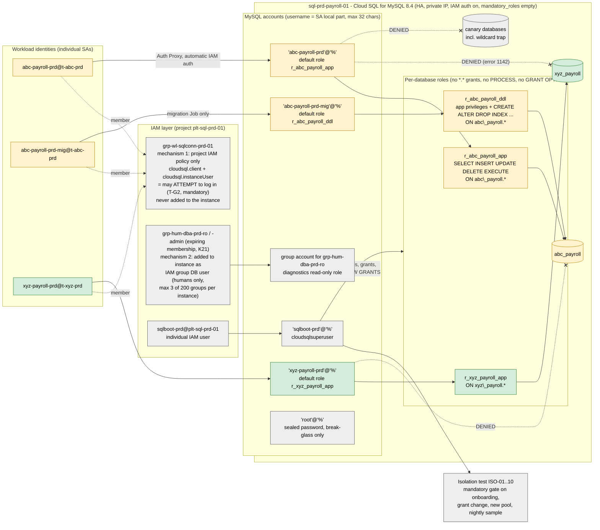

*Source: [`diagrams/13-mysql-privilege-model.mmd`](../diagrams/13-mysql-privilege-model.mmd)*

ABC and XYZ share `sql-prd-payroll-01`. Each has its own MySQL account (named after its own SA), its own per-database role and grants on its own **escaped** database name only. The connect group lets both *attempt* a login, and MySQL refuses everything except their own database. The bootstrap identity proves this with ISO-01…10 before any deployment. Full design: [`database-architecture-mysql.md`](../documentation/database-architecture-mysql.md).

### 4.5 Controlled data movement from Prod to non-production

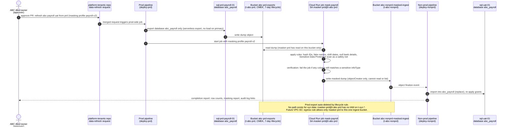

*Source: [`diagrams/09-prod-to-nonprod-data-flow.mmd`](../diagrams/09-prod-to-nonprod-data-flow.mmd)*

**Rules [R]:**

1. **One direction only:** data flows Prod → non-prod, never the reverse path for data, and never through human laptops.
2. **Prod side does the work:** the export and masking run with prod identities (`masker-prd@t-abc-prd`). Non-prod identities never get read access to prod.
3. **Write-only drop:** the masking job can *create* objects in `abc-nonprd-masked-ingest` but cannot read or list it.
4. **Masking is product-specific:** each product team owns a masking profile (which columns to hash, fake, shift or null). Sensitive Data Protection is a safety net that fails the job if anything still looks sensitive.
5. **Same customer only:** the masker in `t-abc-prd` has no IAM on `t-xyz-*`, so cross-customer data movement is impossible by construction.
6. **Approval + audit:** every refresh is a PR approved by the customer's data owner; audit logs record every read and write.
7. **Exceptions:** if a customer contract requires real prod data in UAT **[Q5]**, that customer's UAT moves to the prod tier instead of weakening these rules.

**Non-data flows** (configuration, reference data, feature flags) move forward Dev → Stage → UAT → Prod through Git and the deployment pipeline, not through data copies.

---

## 5. Security and networking

### 5.1 Identity and access

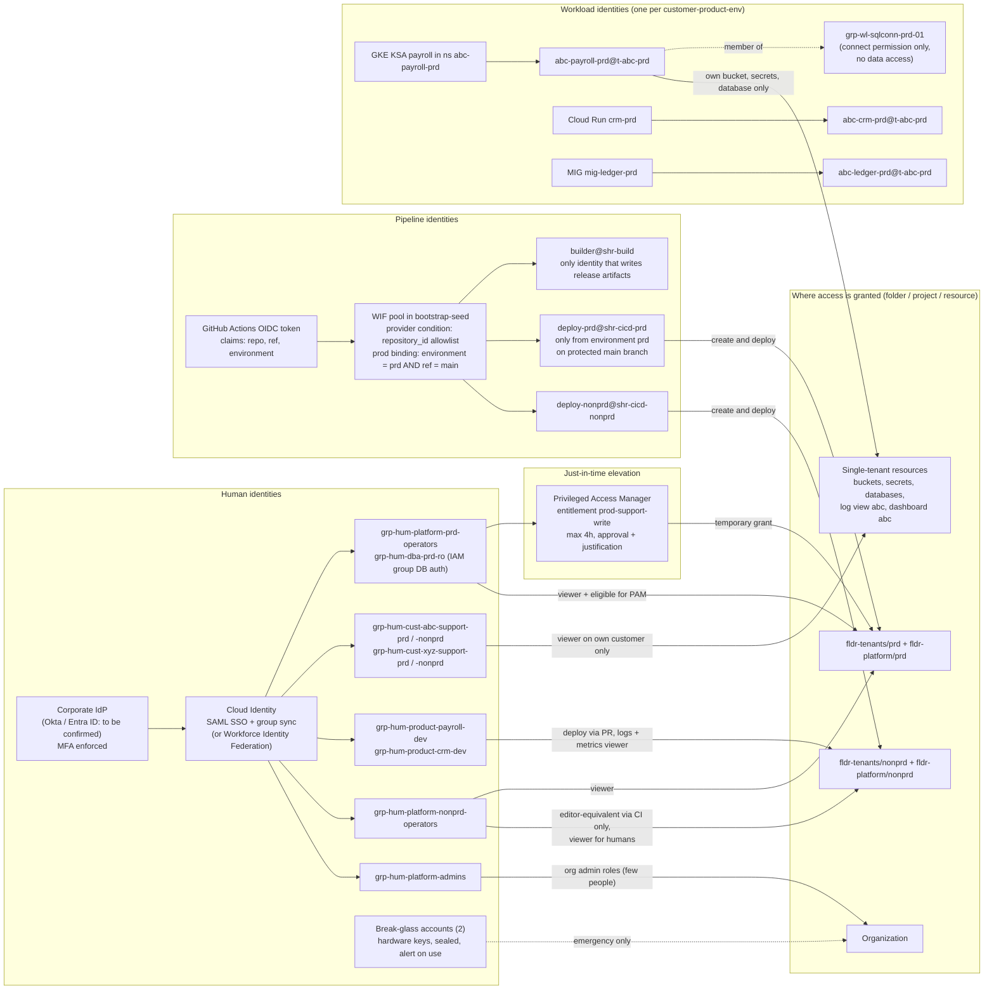

*Source: [`diagrams/10-identity-access.mmd`](../diagrams/10-identity-access.mmd)*

**Authentication vs authorisation:**

| | Authentication (*who are you?*) | Authorisation (*what may you do?*) |
|---|---|---|
| Humans | Corporate IdP with MFA → Cloud Identity SSO (or Workforce Identity Federation) **[Q: which IdP]** | IAM roles granted to **groups** at folder/project/resource level; Kubernetes RBAC bound to the same groups |
| Pipelines | GitHub OIDC token exchanged through the WIF pool; provider condition on repository ID; the prod deployer binding requires `environment = prd` and the protected `main` ref; runner machines' own SAs have no deploy rights (ADR-010) | The deployer SA's IAM roles (non-prod or prod, never both); `builder@shr-build` is the only writer of release artifacts |
| Workloads | Workload Identity (GKE), service identity (Cloud Run), attached SA (VMs) | IAM on the customer's own resources + database privileges; fleet-wide permissions (connect to pools, pull artifacts, use subnets) via `grp-wl-*` groups (ADR-009) |
| Databases | IAM database authentication for workloads (individual IAM SA accounts) and humans (IAM group authentication for DBA groups); no application passwords | MySQL per-database roles and grants; `sqlboot-<tier>` is the only automation identity with `cloudsqlsuperuser` |

**Personas (summary – the full access matrix is Stage 3):**

| Persona | Non-prod | Prod |
|---|---|---|
| Platform administrators | Admin via Terraform; few people | Org/folder admin roles held by a very small group; all changes via pipeline |
| DevOps engineers | Viewer; changes via PR | Viewer; JIT elevation for incidents |
| Product development teams | Deploy their product via PR; logs/metrics viewer for their product | Logs/metrics viewer for their product; no write |
| Customer-specific users (internal staff assigned to a customer) **[A2]** | Viewer on that customer's resources, log view and dashboard | Same, read-only |
| Production support engineers | Viewer | Viewer + eligible for **Privileged Access Manager** entitlements (time-bound, approved, logged) |
| Automated pipelines | `deploy-nonprd` | `deploy-prd`, usable only from the protected `prd` environment |

**Groups and identity categories (final reconciliation):** humans, pipelines and workloads are separate identity categories; groups aggregate identical non-data permissions only, and every workload keeps its own SA. Full group list, automation, review and revocation: [`identity-and-groups-model.md`](../documentation/identity-and-groups-model.md).

**Break-glass:** two emergency accounts with hardware security keys, credentials sealed, used only when the IdP or PAM is unavailable; any login fires an alert to the security team **[R]**. *(Stage 3 D7, K25:* these are the non-federated Cloud Identity super-admin accounts; they hold no IAM roles and add a named engineer to the empty `grp-hum-prd-breakglass` group with an expiry, so both descriptions of break-glass are the same mechanism – `security/privileged-access.yaml`.)

### 5.2 Network isolation and traffic controls

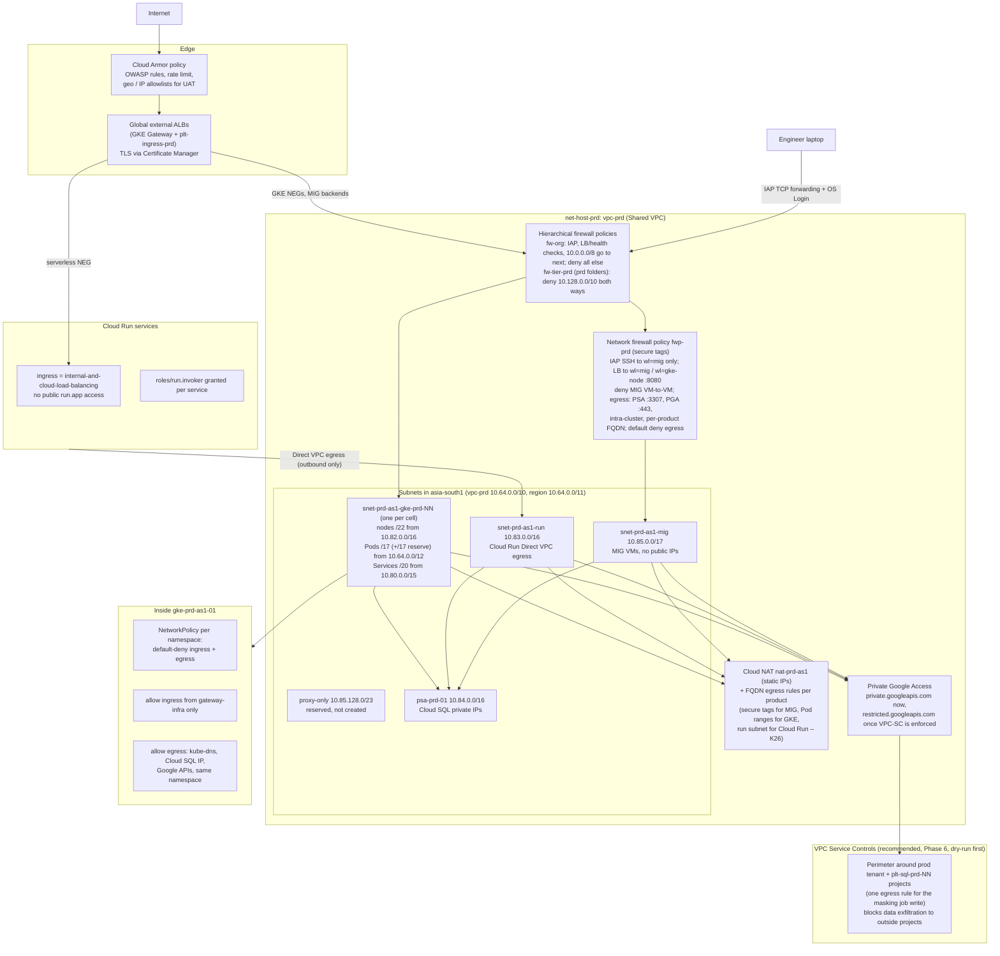

*Source: [`diagrams/11-network-security.mmd`](../diagrams/11-network-security.mmd)*

| Control | Design [R] |
|---|---|
| Shared VPC | Two host projects (`net-host-prd`, `net-host-nonprd`). Tenant and platform projects are service projects. Network admins own subnets and firewall; tenant projects cannot change them |
| Segmentation | Prod and non-prod are separate VPCs, not peered. Inside a VPC, subnets per workload type (GKE, Cloud Run egress, MIG, proxy-only) |
| No VPC per customer | Rejected: peering/NCC limits at 400+ VPCs and no isolation gain over IAM + firewall + NetworkPolicy for single-tenant deployments (ADR-001) |
| Firewall | Hierarchical policy at org and `prd` folder: allow only Google LB/health-check ranges and IAP; deny everything else. Network firewall policies with **secure tags** for workload-level rules (MIG VMs accept traffic from the LB only, no VM-to-VM) |
| Kubernetes | NetworkPolicy default-deny in every tenant namespace, applied by the namespace module so it cannot be forgotten |
| Ingress | Only through global external ALBs with Cloud Armor. GKE nodes are private; Cloud Run ingress = internal + LB; MIG VMs have no public IPs |
| Egress | Cloud NAT for outbound internet, with Cloud NGFW rules (FQDN objects, paid tier) allowing only named FQDNs per workload; default deny. Rules use secure tags for VMs/GKE nodes and **network tags for Cloud Run** *(Stage 4 K26: firewall-policy rules cannot target Cloud Run by tag, so Cloud Run egress is matched by its subnet – see `documentation/stage-4-networking.md`)* (Resource Manager tags are not usable in firewall rules for Cloud Run – review F3). Google APIs via Private Google Access on `private.googleapis.com`, switching to `restricted.googleapis.com` when VPC-SC is enforced (K6) |
| Cloud SQL connectivity | Private IP via private services access in each host VPC **[R]**; the allocated range must be sized for the pool counts in the capacity model (B3); Private Service Connect is the alternative if ranges become a problem. Cloud Run egress subnets need ~2 IPs per instance (B8) |
| Admin access | IAP TCP forwarding + OS Login; no bastions, no SSH keys, no public IPs |
| Exfiltration control | VPC Service Controls perimeter around prod tenant and `plt-sql-prd-*` projects – **recommended for Phase 6, introduced in dry-run mode first** because it can break legitimate flows; it needs one explicit egress rule for the masking job's write to non-prod (K7) |
| Hybrid connectivity | **Not designed** – no on-premises connection is mentioned in the assignment **[A10, Q9]** |

### 5.3 Secrets and encryption

- **Secret Manager** in each tenant project holds that customer's secrets; workloads read them with their own identity. Names follow `<product>-<env>-<name>` **[R]**.
- **Who writes secret values:** generated by automation where possible (database access uses IAM auth, so there are no DB passwords); third-party credentials are added by the owning team through a controlled process, never committed to Git.
- **Encryption at rest:** Google-managed encryption by default everywhere; **CMEK** with customer-specific keys (`kr-<cust>-<tier>-<region>`) for prod buckets and secrets **[R]**. Pooled Cloud SQL instances use one CMEK key per instance (Cloud SQL CMEK is instance-level), which is a known limit of pooling; dedicated-tier databases get a customer-specific key.
- **Key placement trade-off:** keys live in the tenant project in this baseline. A central key project per tier gives stronger separation of duties (key admins ≠ data admins) at the cost of more cross-project IAM – a reasonable alternative to confirm with the security team **[Q]**.
- **In transit:** TLS at the load balancer (Certificate Manager, wildcard per product per tier), Cloud SQL connector (TLS + IAM), Google API calls over TLS.

### 5.4 Production vs non-production restrictions (summary)

| Area | Non-prod | Prod |
|---|---|---|
| Network | `vpc-nonprd` | `vpc-prd`, no connection to non-prod |
| Deployer | `deploy-nonprd`, runner pool `shr-cicd-nonprd` | `deploy-prd`, runner pool `shr-cicd-prd` (runner group limited to platform workflows), protected environment, 2 approvals |
| Artifacts | `release` + `snapshot` (Dev only) | `release` only, by digest, signed (Binary Authorization **[R]**) |
| Terraform state | `tfstate-nonprd` | `tfstate-prd` (separate IAM) |
| Human write access | Via PR only | None standing; PAM JIT with approval |
| Data | Synthetic or masked only | Real customer data |
| Org policies | Baseline | Baseline + stricter (e.g. CMEK required, deletion protection, restricted services) |
| Cost controls | Scale-to-zero / scheduled scale-down | Sized for SLOs |

---

## 6. Scalability and high availability

### 6.1 Growth across variable product subscriptions (revised in review A1)

Stage 2 assumed ~3 products per customer. The number is not fixed: a customer may subscribe to 1 product or to most of the catalogue **[A14]**, and the runtime mix is unknown **[A15]**. The full model – 200 and 500 customers × 1, 3, 5, 10, 15 and 20 products, split by GKE / Cloud Run / MIG and by deployment model – is in [`documentation/capacity-model.md`](../documentation/capacity-model.md). Key results (illustrative inputs):

| Resource | 200 × 3 (baseline) | 200 × 10 | 500 × 10 | 500 × 20 (upper bound) | Design response |
|---|---|---|---|---|---|
| Subscriptions | 600 | 2,000 | 5,000 | 10,000 | Registry holds one block per subscription |
| Dedicated deployments (4 envs) | 2,400 | 8,000 | 20,000 | 40,000 | Mixed deployment models remove ~40% at high adoption (ADR-006) |
| Tenant projects (2 per customer) | 400 | 400 | 1,000 | 1,000 | Fixed per customer – adding a product never adds a tenant project |
| Product projects (Shared/Cohort only) | 0–16 | 0–16 | 0–16 | 0–16 | Bounded by the catalogue: ≤ 2 per Shared/Cohort product (illustrative mix: 16) |
| Infrastructure projects (core + SQL pool + observability shards) | 16 | 17 | 21 | 26 | Grow with sharding, not per customer (capacity model T6) |
| GKE clusters (prod + dev + stg + uat), 50% GKE | 4 | 4 | 12 | 20 | One cluster per environment, cells added per environment (ADR-008) |
| Cloud SQL for MySQL instances incl. prod DR replicas (revision 2 model) | ~61 | ~186 | ~442 | ~844 | Product-group prod pools at low adoption (5 instead of 20 prod pools at 200 × 1), split per product by rule; tenants per pool = tightest of tenant, connection, storage and 50,000-table limits (ADR-003 rev. 3) |
| IAM appearances in a pool-project policy | 2–10 (group-based) | 2–10 | 2–10 | 2–10 | Per-SA grants would exceed 1,500; fallback if test T-G2 fails: shard pool projects by SA count (ADR-009 rev. 2) |
| Metrics scopes per tier | 1 | 1 | 2 | 2 | Shard `plt-obs-<tier>-NN` at ~375 projects (K27) |
| Shared VPC service projects per host | ~200 | ~200 | ~500 | ~500 | Check the actual per-host quota before Phase 1 **[Q20]**; sharding a host means a new VPC, so it would be done per network cell |

### 6.2 GKE capacity and sharding (cells) [R] – revised (ADR-008)

- **One Autopilot cluster per environment.** Namespaces per cluster = subscriptions × GKE share, identical for Dev, Stage, UAT and Prod, so one sizing rule applies everywhere. The Stage 2 single non-prod cluster would have carried 3× that number and crossed the threshold at 200 customers × 5 products.
- An Autopilot cluster supports up to 5,000 nodes, so node count is rarely the first limit. The practical limits are **upgrade blast radius**, **IP ranges**, **API-server/etcd load** from many namespaces and objects, and **noisy neighbours**.
- **Cell rule – a planning assumption to validate by load testing, not a GCP limit [A13]:** add a cell `gke-<env>-as1-02` when a cell reaches ~1,000 tenant namespaces, ~40% of the node limit, ~70% of the Pod IP range, or when a product needs different cluster-level settings.
- **Placement** is per subscription and environment, sticky, with customer affinity; existing tenants move only by a deliberate migration PR.
- **Upgrades** flow Dev → Stage → UAT → Prod, one cell at a time.

### 6.3 Cloud SQL for MySQL sharding and tenant placement [R] – revised (ADR-003 rev. 3)

- Non-prod pools per environment (`sql-dev-NN`, `sql-stg-NN`, `sql-uat-NN`), shared by products on the same MySQL major version **[A17]**; prod pools per **product group**, split per product when a product fills ≥ 50% of a pool, needs a different version/maintenance window, uses > 50% of a pool's load, or a contract requires it (capacity model).
- **Tenants per pool** = the tightest of: tenant-count cap, connection budget (`max_connections` × 70% ÷ peak connections per tenant), storage/restore cap after growth, and the **50,000-table default limit per instance** (M4).
- **Pool projects sharded** (`plt-sql-prd-01`, `-02` …, planning ceiling 100 instances including replicas; documented limit up to 1,000 per project).
- **IAM:** connect permission via `grp-wl-sqlconn-<tier>-NN` per pool project; per-tenant authorisation only inside MySQL (per-database roles, escaped grants, no global privileges), proven by ISO-01…10.
- **Connections:** application-side pooling + connection budget + per-account `MAX_USER_CONNECTIONS` (T-M3). Managed Connection Pooling for MySQL requires **Enterprise Plus** and restarts the instance when enabled; IAM-authentication support is not documented for MySQL → optional after test T-M5 **[Q16]**.
- **Moving a tenant:** per-database export/import into another pool or a dedicated instance.

### 6.4 CI/CD deployment concurrency [R] – revised

- **State per stack and per tier** (`tfstate-nonprd`, `tfstate-prd`; stacks such as `tenants/abc/prd`), so many tenants apply in parallel; GCS state locking prevents two applies on one stack.
- **GitHub concurrency groups** per stack serialise runs for the same tenant.
- **Fleet-wide changes run per product, in waves** (canary tenants → 10% → rest). At 20 parallel jobs, patching one product for every customer and environment takes ~0.1–6.7 h across the scenarios; redeploying everything would take up to ~133 h, so it is never done as one operation. Parallelism is raised as adoption grows, within GitHub limits and Google admin-API write quotas (B9).
- **Runners:** ephemeral, one job per runner, separate prod/non-prod pools, prod runner group restricted to platform workflows; builds run only in `shr-build` (ADR-010). Running deploy runners on Actions Runner Controller in a small Autopilot cluster per `shr-cicd-*` project is the proposed option; GitHub-hosted runners are an alternative to evaluate **[Q14]**.

### 6.5 Monitoring at customer and platform level [R]

- **Labels carry tenant identity everywhere:** namespace labels → Prometheus metrics; Cloud Run/MIG/Cloud SQL labels; log entries carry the project and namespace.
- **Customer level:** a templated dashboard per customer (all their products, all environments), uptime checks per customer hostname, SLOs per customer per product in prod (availability and latency from load-balancer metrics).
- **Product level:** fleet dashboard per product with a tenant filter; error-budget burn alerts routed to the product team.
- **Platform level:** cluster health, Cloud SQL pool saturation, quota usage, pipeline success rate, certificate expiry; routed to the platform on-call.
- **Customer-specific access to logs:** log views filtered per tenant, granted to `grp-hum-cust-<cust>-support-<tier>` (K22: one group per tier). Cloud Run and MIG logs already sit in the tenant's own projects. GKE logs sit in the cluster project, where a log bucket allows 30 log views by default (increasable to 1,000), so per-tenant views are created per cell bucket with a quota increase; routing tenant logs to tenant projects is the alternative (review B5).
- **Metrics scopes** are sharded per tier at ~375 projects (guaranteed-performance guidance), i.e. 2 per tier at 500 customers.
- Native Cloud Monitoring, Cloud Logging and Managed Prometheus are enough; Grafana is optional (it can query Managed Prometheus) and is not required by this design **[R]**.

### 6.6 High availability, backup and DR

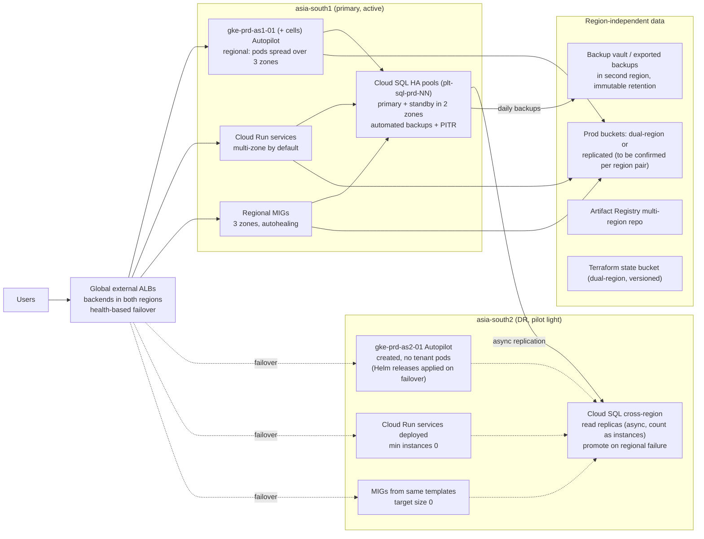

*Source: [`diagrams/12-dr-topology.mmd`](../diagrams/12-dr-topology.mmd)*

| Failure | What happens | RPO / RTO target **[A8 – placeholders]** |
|---|---|---|
| Pod crash | Kubernetes restarts it; readiness probe keeps it out of traffic | 0 / seconds |
| GKE node failure | Autopilot replaces the node; PDB + multiple replicas keep service up | 0 / minutes |
| Cloud Run instance failure | Platform replaces it automatically | 0 / seconds |
| MIG VM failure | Autohealing recreates it from the template | 0 / minutes |
| Zone failure | Regional GKE, Cloud Run and MIGs continue in other zones; Cloud SQL HA fails over to the standby | ~0 / minutes |
| Region failure | Promote Cloud SQL cross-region replicas, apply Helm releases to the pilot-light DR cluster, scale DR MIGs, LBs fail over | ≤ 15 min / ≤ 4 h |
| One customer's data corrupted | PITR clone of the pool to a temporary instance → copy that customer's database back (runbook from Stage 1b) | minutes / hours |
| Bad deployment | Helm rollback / Cloud Run traffic shift / MIG previous template | 0 / minutes |

**Backups [R]:** automated daily backups + PITR on all prod and UAT instances; on-demand backup before every prod migration; backups copied/retained in a second region (backup vault with retention lock where available) so a regional loss or an accidental instance deletion is recoverable. Non-prod Dev/Stage pools: automated backups only.

**Stage 8:** the A8 values above are now the design targets in [`slo/dr.yaml`](../slo/dr.yaml), checked by `tools/slo/dr.py` (BC01–BC06); the region row applies once regional DR is activated (Q10) – until then the interim target is RPO ≤ 24 h / RTO ≤ 48 h (R-S8-3). See [`documentation/stage-7-8-cicd-cost-slo.md`](../documentation/stage-7-8-cicd-cost-slo.md) §3.

**Pilot-light DR** is cheap with Autopilot and Cloud Run because an empty Autopilot cluster runs no tenant pods and Cloud Run with `min_instances 0` costs nothing while idle. Whether the business needs regional DR at all is a cost decision **[Q]**. DR must be rehearsed (at least one game day per year, assumption).

---

## 7. Architecture decisions (ADR summary)

Full records: [`architecture/decisions/`](decisions/). ADRs 003 and 006 were revised and 008–010 added in the Stage 2 review; ADR-003, 004, 006 and 009 were revised and ADR-011 added in the final reconciliation.

| ADR | Decision | Main alternative | Revisit when |
|---|---|---|---|
| [001](decisions/ADR-001-hybrid-project-model.md) | Hybrid: per-customer tenant projects for data/identity, pooled runtimes | Project per customer-env with own runtime; fully shared projects | Most customers need dedicated infra, or pooling breaks a contract |
| [002](decisions/ADR-002-environment-first-folders.md) | Environment-first folders | Customer-first folders | Customers have very different policies from each other |
| [003](decisions/ADR-003-pooled-cloud-sql-database-per-tenant.md) *(rev. 3)* | Pooled Cloud SQL for MySQL, database per customer-product, per-database roles, hardening baseline + isolation test, product-group prod pools, sharded pool projects, connection budget | Schema per customer-product; dedicated instance per customer | Restore-per-customer RTO or isolation is contractually insufficient |
| [004](decisions/ADR-004-dedicated-database-tier.md) | Dedicated instance as an opt-in tier | Dedicated for all; never dedicated | Share of dedicated customers grows above ~25% |
| [005](decisions/ADR-005-gke-autopilot-default.md) | GKE Autopilot by default | GKE Standard | Required agents or workloads are not supported on Autopilot |
| [006](decisions/ADR-006-product-deployment-models.md) *(rev. 3)* | Dedicated (default), Shared, Cohort – product projects, registry fields, savings qualified as illustrative, database-per-tenant on MySQL | Force one model for all products | Product teams confirm which products are multi-tenant |
| [007](decisions/ADR-007-two-projects-per-customer.md) | Two projects per customer (prd, nonprd) | One per environment; three (prd, uat, dev-stg) | UAT must be separated from Dev/Stage, or quotas collide |
| [008](decisions/ADR-008-gke-cluster-topology-and-cells.md) *(new)* | One GKE cluster per environment, sharded into cells | One non-prod cluster; cluster per product | Load tests show different thresholds |
| [009](decisions/ADR-009-fleet-iam-via-groups.md) *(rev. 2)* | Hybrid identity model: groups aggregate identical non-data permissions; workload SAs stay individual; IAM group DB auth for humans only | Individual bindings everywhere; groups for everything | Test T-G2 fails, or per-instance Cloud SQL IAM appears |
| [010](decisions/ADR-010-build-deploy-separation.md) *(new)* | Separate build (`shr-build`) from deploy; signed artifacts; state and runners per tier | Separate registries per tier with promotion copies | A central company build/signing system exists |
| [011](decisions/ADR-011-cloud-sql-for-mysql.md) *(new)* | Cloud SQL for MySQL 8.4 as the default relational database | Cloud SQL for PostgreSQL; MySQL 8.0 / 9.7 | A product needs PostgreSQL-only features; MySQL 9.x becomes default and certified |

---

## 8. Change log

### 8.1 Changes since Stage 1b (Stage 2, all deliberate)

| # | Change | Reason |
|---|---|---|
| 1 | Names finalised with consistent prefixes (`plt-`, `shr-`, `net-`, `t-`) | Consistency |
| 2 | Dedicated-tier projects live in `tenants/prd` and `tenants/nonprd` with a tag (Stage 1 sketched a separate `dedicated/` folder) | Inherit every prod/non-prod policy |
| 3 | CI/CD and observability split into prod and non-prod projects | Prod credentials never on non-prod runners; metrics-scope guidance |
| 4 | `plt-ingress-*` projects for Cloud Run and MIG front doors; GKE uses its own Gateway | Cross-project backend service referencing |
| 5 | UAT pool recommended as HA (Dev/Stage zonal) | Optional, cost trade-off **[Q15]** |
| 6 | Cloud SQL private connectivity via private services access, PSC as alternative | Was unspecified |

### 8.2 Changes from the Stage 2 architecture review (see the review for evidence)

| Review ID | Change | Where |
|---|---|---|
| A1 | Variable-subscription capacity model; **one GKE cluster per environment** with cells; product-group prod pools; sharded pool projects | §6, diagrams 01/02/08/12, ADR-008, ADR-003 rev. 2, capacity model |
| A2 | Fleet-wide IAM via Google groups (`grp-wl-*`) | §1.3, §2A, §5.1, §6.3, diagrams 02/03/06/10, ADR-009 |
| A3 | PostgreSQL hardening baseline + cross-tenant denial test – **superseded by M1–M3 after the switch to MySQL** | §2A, §3.2, §4.4, diagrams 03/06/08, ADR-003 rev. 2 |
| A4 | Connection budget; Managed Connection Pooling only on Enterprise Plus after validation | §6.3, ADR-003 rev. 2, Q16 |
| A5 | `shr-build`, release/snapshot repos, signed artifacts, Binary Authorization [R], state bucket per tier, runner groups, WIF conditions | §1.1, §1.3, §2C, §5.1, §5.4, §6.4, diagrams 01/02/05/10, ADR-010 |
| A6 | Hostnames derived from registry; HTTPRoute admission policy; generated and tested URL maps | §2A, §3.1, §4.4, diagram 03 |
| A7 | Registry schema v2 (per-env placement, subscription blocks, Shared/Cohort), product projects, `env_tier` / `isolation_tier` labels | §0, §3.1, diagram 01, ADR-006 rev. 2 |
| K6, K7, K12, K14 | PGA VIP, Cloud Run network tags, VPC-SC egress rule for masking, NetworkPolicy egress for DNS/metadata, backup retention note | §5.2, §3.3, diagrams 03/07/09/11 |

### 8.3 Changes from the Stage 2 final reconciliation (MySQL, groups, capacity)

| Review ID | Change | Where |
|---|---|---|
| M1 | Workload SA IDs include the customer (`abc-payroll-prd`) because the MySQL IAM username is the SA local part (≤ 32 chars) – prevents account collisions on shared pools | §0, §2, §4.3, §4.4, diagrams 03/04/05/06/08/10 |
| K18 | Corrected SA length budget: customer ≤ 10, product ≤ 11 → migration SA max 30 (was 31); registry schema v2.1, validator and boundary tests | §0, §3.1, `registry/naming-rules.md`, `scripts/validate_names.py` |
| K19–K20 | Workload groups vs human role groups wording; IAM-policy groups (workloads) vs Cloud SQL IAM group authentication (human DBAs, ≤ 3 of 200 groups per instance) | identity model §1/§4a, ADR-009 rev. 2, database architecture §3 |
| M2–M3 | MySQL privilege model: per-database roles, escaped grants, no global privileges / `PROCESS`, `mandatory_roles` empty, DEFINER controls | §2A, §3.2, §4.4, database architecture, ADR-003 rev. 3 |
| M4 | 50,000-table default limit per instance used in pool sizing | §6.3, capacity model |
| M5 | Pooling: app-side default; Managed Connection Pooling (Enterprise Plus) only after T-M5 | §6.3, database architecture §8 |
| M6–M8 | Separate migration identity, expand/contract, bootstrap identity, single-tenant restore on MySQL | database architecture §6–§10 |
| G1–G5 | Hybrid groups model; IAM group DB auth for humans only; GKE customer logs routed to tenant projects | §1.3, §5.1, identity model, ADR-009 rev. 2, diagram 10 |
| C1–C3 | Capacity reconciled with product groups; project categories; Shared/Cohort savings qualified | §6.1, §6.3, capacity model rev. 2, ADR-006 rev. 3 |

---

## 9. Stage checklist

**Completed in Stage 2**

- [x] Resource hierarchy diagram (01) and overall platform diagram (02) with component responsibilities
- [x] GKE (03), Cloud Run (04) and MIG (05) runtime diagrams with request, deployment and version flows
- [x] Onboarding workflow (06) and day-2 lifecycle: new product, upgrade, offboarding (07)
- [x] ABC/XYZ worked example: version matrix, 16-row resource mapping, diagram (08), isolation controls
- [x] Controlled Prod → non-prod data movement (09)
- [x] Identity/access (10) and network/security (11) design
- [x] HA/DR design (12) with placeholder RPO/RTO
- [x] ADRs 001–011, assumptions/open-questions register, requirements traceability

**Completed in the final reconciliation**

- [x] Cloud SQL for MySQL 8.4 database architecture, isolation, bootstrap and isolation test; hybrid groups and identity model; capacity model revision 2

**Completed in the Stage 2 review**

- [x] Capacity model for 1–20 products per customer at 200 and 500 customers
- [x] Feasibility, security-path and consistency review; critical issues A1–A7 corrected in documents, diagrams and ADRs

**Remaining (next stages)**

- [x] Stage 3: full access-control matrix (roles per persona per scope, groups, PAM entitlements, per-tenant prod deployers – B1), org policy list, Policy Controller constraints (B11/B12), audit/alerting rules – done, see [`stage-3-security-implementation.md`](../documentation/stage-3-security-implementation.md); B1 decided as a tier-wide prod deployer for now (R-D6-4)
- [x] Stage 4: IP address plan (GKE, Cloud Run egress, PSA ranges – B3/B8), DNS, firewall rule catalogue, NetworkPolicy catalogue (B17), connection budgets, quota register (B14) – done, see [`stage-4-networking.md`](../documentation/stage-4-networking.md) (NetworkPolicies in D8, connection budgets in D4)
- [x] Stage 5: Terraform repository structure, modules, state layout, examples for ABC/XYZ – see [`stage-5-6-terraform-helm.md`](../documentation/stage-5-6-terraform-helm.md); examples in `examples/`
- [x] Stage 6: Helm chart structure, values layering for 2 customers × 2 products; Ansible role layout – Helm for the GKE product (payroll, both customers), CRM is Cloud Run (Terraform shell + pipeline deploy, A-H-2); Ansible in `ansible/`
- [ ] Stage 7: CI/CD workflows (validate, plan, apply, deploy, promote), GitOps-vs-portal evaluation, fleet rollout waves (B9)
- [ ] Stage 8: SLO/alert catalogue, failure runbooks (Terraform/CI), cost model and billing labels, roadmap, final decisions and limitations
- [ ] Company confirmation of the open questions in [`documentation/assumptions-and-open-questions.md`](../documentation/assumptions-and-open-questions.md)
