# Architecture diagrams

GitHub renders the Mermaid diagrams below directly from source. The `.mmd` files are the editable source of truth; SVG exports are retained in `rendered/` for external viewing.

## 01-resource-hierarchy — Resource Hierarchy

```mermaid
%% 01 - GCP resource hierarchy (environment-first)
%% Status: PROPOSED baseline, revised in Stage 2 review (A1, A5, A7, K2, K16); Stage 8 K27 (plt-obs-<tier>-NN).
%% Project IDs get a random suffix in reality, e.g. t-abc-prd-x7k2. NN = shard number (01, 02 ...).
flowchart TB
  ORG["Organization: example.com<br/>org policies: no SA keys, no default network,<br/>allowed regions, uniform bucket access, OS Login"]

  ORG --> FB["fldr-bootstrap"]
  ORG --> FS["fldr-shared"]
  ORG --> FN["fldr-network"]
  ORG --> FP["fldr-platform"]
  ORG --> FT["fldr-tenants"]

  FB --> P_SEED["bootstrap-seed<br/>state buckets: tfstate-org, tfstate-nonprd, tfstate-prd<br/>(separate IAM per tier)<br/>WIF pool for GitHub OIDC"]

  FS --> P_BLD["shr-build<br/>build runners, builder SA,<br/>signing / attestations"]
  FS --> P_ART["shr-artifacts<br/>Artifact Registry: release (build-only write),<br/>snapshot (Dev only)"]
  FS --> P_CIN["shr-cicd-nonprd<br/>runner pool + deploy-nonprd"]
  FS --> P_CIP["shr-cicd-prd<br/>runner pool + deploy-prd"]
  FS --> P_SEC["shr-security<br/>audit log bucket (locked), SCC exports"]

  FN --> P_NHP["net-host-prd<br/>Shared VPC host: vpc-prd"]
  FN --> P_NHN["net-host-nonprd<br/>Shared VPC host: vpc-nonprd"]

  FP --> FPP["prd"]
  FP --> FPN["nonprd"]
  FPP --> P_GKEP["plt-gke-prd<br/>gke-prd-as1-01 (+ cells -02 ...)<br/>only platform cells in this project"]
  FPP --> P_SQLP["plt-sql-prd-NN<br/>prod pools per product group / product<br/>e.g. sql-prd-payroll-01, sql-prd-crm-01"]
  FPP --> P_INGP["plt-ingress-prd<br/>global external ALBs + Cloud Armor<br/>(Cloud Run and MIG products)"]
  FPP --> P_PRODP["p-product-prd<br/>only for Shared / Cohort products"]
  FPP --> P_OBP["plt-obs-prd-NN<br/>metrics scope, SLOs, alerts (K27)<br/>sharded at ~375 projects"]
  FPN --> P_GKEN["plt-gke-nonprd<br/>gke-dev-as1-01, gke-stg-as1-01,<br/>gke-uat-as1-01 (+ cells)"]
  FPN --> P_SQLN["plt-sql-nonprd-NN<br/>sql-dev-NN, sql-stg-NN, sql-uat-NN"]
  FPN --> P_INGN["plt-ingress-nonprd"]
  FPN --> P_PRODN["p-product-nonprd<br/>only for Shared / Cohort products"]
  FPN --> P_OBN["plt-obs-nonprd-NN<br/>metrics scope (K27)"]

  FT --> FTP["prd<br/>strict prod policies + prod access groups"]
  FT --> FTN["nonprd"]
  FTP --> T_ABCP["t-abc-prd<br/>tag isolation_tier=standard"]
  FTP --> T_XYZP["t-xyz-prd<br/>tag isolation_tier=standard"]
  FTP --> T_BIGP["t-bigco-prd<br/>tag isolation_tier=dedicated<br/>own GKE cluster + own Cloud SQL"]
  FTN --> T_ABCN["t-abc-nonprd<br/>Dev + Stage + UAT"]
  FTN --> T_XYZN["t-xyz-nonprd<br/>Dev + Stage + UAT"]
  FTN --> T_BIGN["t-bigco-nonprd<br/>uses shared non-prod tiers by default (Q18)"]

  P_NHP -. "subnets shared with service projects in" .-> FPP
  P_NHP -. "subnets shared with service projects in" .-> FTP
  P_NHN -. "subnets shared with service projects in" .-> FPN
  P_NHN -. "subnets shared with service projects in" .-> FTN

  classDef prd fill:#fde2e1,stroke:#c0392b,color:#000
  classDef nonprd fill:#e1ecfd,stroke:#2c6fbb,color:#000
  classDef shared fill:#eeeeee,stroke:#555,color:#000
  class FPP,FTP,P_GKEP,P_SQLP,P_INGP,P_PRODP,T_ABCP,T_XYZP,T_BIGP,P_NHP,P_CIP,P_OBP prd
  class FPN,FTN,P_GKEN,P_SQLN,P_INGN,P_PRODN,T_ABCN,T_XYZN,T_BIGN,P_NHN,P_CIN,P_OBN nonprd
  class FB,FS,FN,FP,FT,P_SEED,P_ART,P_SEC,P_BLD shared
```

- [Mermaid source](01-resource-hierarchy.mmd) · [SVG export](rendered/01-resource-hierarchy.svg)

## 02-platform-architecture — Platform Architecture

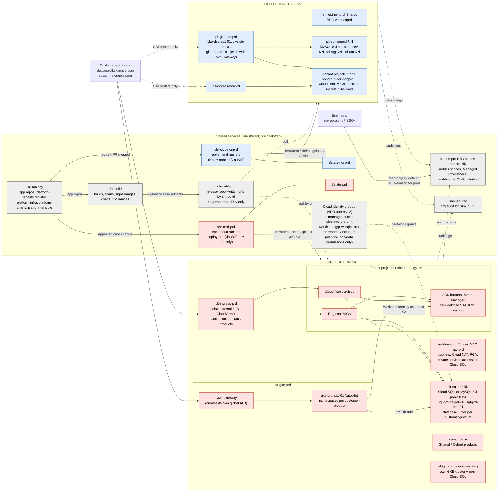

- [Mermaid source](02-platform-architecture.mmd) · [SVG export](rendered/02-platform-architecture.svg)

## 03-gke-runtime — Gke Runtime

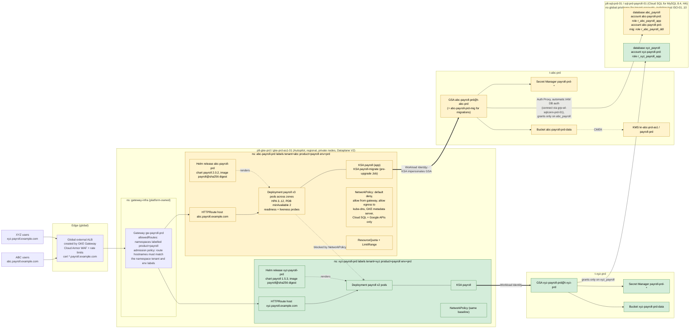

- [Mermaid source](03-gke-runtime.mmd) · [SVG export](rendered/03-gke-runtime.svg)

## 04-cloudrun-runtime — Cloudrun Runtime

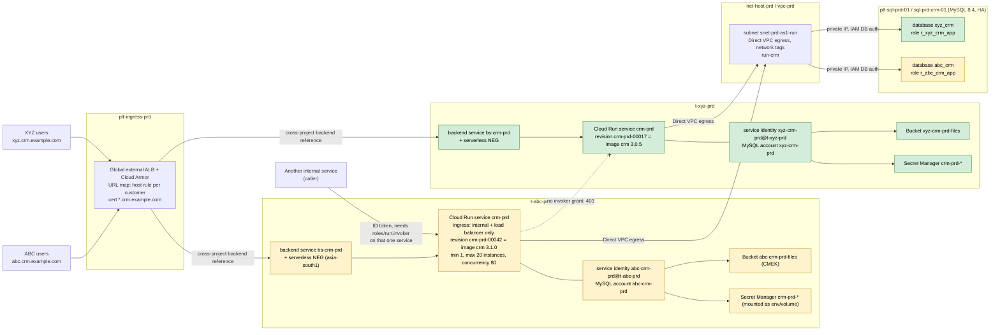

- [Mermaid source](04-cloudrun-runtime.mmd) · [SVG export](rendered/04-cloudrun-runtime.svg)

## 05-mig-runtime — Mig Runtime

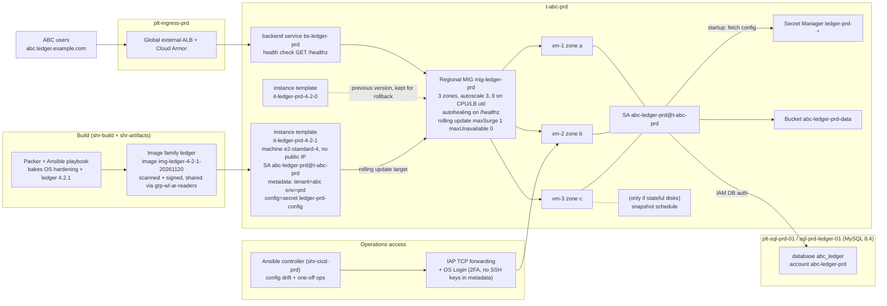

- [Mermaid source](05-mig-runtime.mmd) · [SVG export](rendered/05-mig-runtime.svg)

## 06-onboarding-workflow — Onboarding Workflow

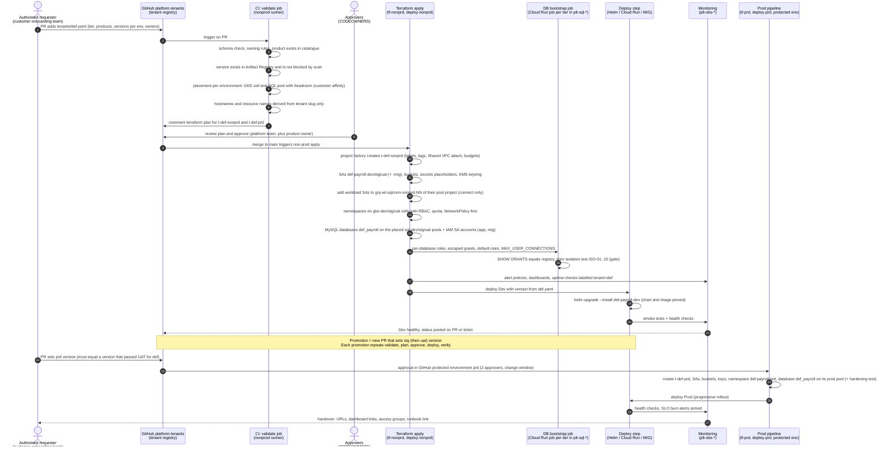

- [Mermaid source](06-onboarding-workflow.mmd) · [SVG export](rendered/06-onboarding-workflow.svg)

## 07-lifecycle-operations — Lifecycle Operations

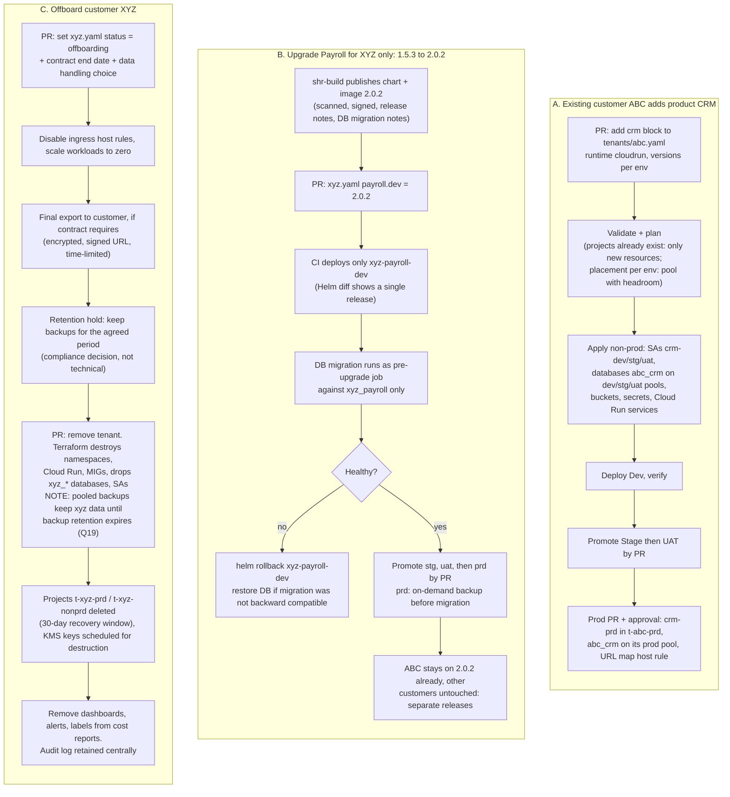

- [Mermaid source](07-lifecycle-operations.mmd) · [SVG export](rendered/07-lifecycle-operations.svg)

## 08-abc-xyz-example — Abc Xyz Example

```mermaid
%% 08 - Worked example: ABC and XYZ, Payroll (GKE) and CRM (Cloud Run), all four environments
%% Versions are illustrative. Each box is owned by exactly one customer unless marked SHARED.
%% Revised in Stage 2 review: one GKE cluster per environment (ADR-008), pool project names, group IAM.
%% Final reconciliation: MySQL 8.4 pools, SA IDs include the customer (M1).
flowchart TB
  subgraph NP["NON-PROD tier"]
    direction LR
    subgraph GKEN["SHARED: plt-gke-nonprd (one cluster per environment)"]
      direction TB
      CDEV["gke-dev-as1-01<br/>abc-payroll-dev v2.1.0<br/>xyz-payroll-dev v2.0.2"]
      CSTG["gke-stg-as1-01<br/>abc-payroll-stg v2.0.3<br/>xyz-payroll-stg v1.5.4"]
      CUAT["gke-uat-as1-01<br/>abc-payroll-uat v2.0.3<br/>xyz-payroll-uat v1.5.4"]
    end
    subgraph TAN["t-abc-nonprd"]
      direction TB
      RA_N["Cloud Run<br/>crm-dev v3.2.0<br/>crm-stg v3.1.1<br/>crm-uat v3.1.1"]
      SA_AN["SAs abc-payroll-dev/stg/uat,<br/>abc-crm-dev/stg/uat (+ -mig)"]
      BK_AN["Buckets abc-payroll-ENV-data,<br/>abc-crm-ENV-files,<br/>abc-nonprd-masked-ingest"]
      SM_AN["Secrets payroll-ENV-*, crm-ENV-*<br/>KMS kr-abc-nonprd-as1"]
    end
    subgraph TXN["t-xyz-nonprd"]
      direction TB
      RX_N["Cloud Run<br/>crm-dev v3.1.1<br/>crm-stg v3.0.5<br/>crm-uat v3.0.5"]
      SA_XN["SAs xyz-payroll-dev/stg/uat,<br/>xyz-crm-dev/stg/uat (+ -mig)"]
      BK_XN["Buckets xyz-PRODUCT-ENV-*,<br/>xyz-nonprd-masked-ingest"]
      SM_XN["Secrets + KMS kr-xyz-nonprd-as1"]
    end
    subgraph SQLN["SHARED: plt-sql-nonprd-01 (MySQL 8.4)"]
      direction TB
      DEV["sql-dev-01 (zonal)<br/>abc_payroll, abc_crm,<br/>xyz_payroll, xyz_crm"]
      STG["sql-stg-01 (zonal)<br/>same four databases"]
      UAT["sql-uat-01 (HA, Q15)<br/>same four databases"]
    end
  end

  subgraph PR["PROD tier"]
    direction LR
    subgraph GKEP["SHARED: plt-gke-prd / gke-prd-as1-01"]
      direction TB
      PA["abc-payroll-prd  v2.0.2"]
      PX["xyz-payroll-prd  v1.5.3"]
    end
    subgraph TAP["t-abc-prd"]
      direction TB
      RA_P["Cloud Run crm-prd v3.1.0"]
      SA_AP["SAs abc-payroll-prd, abc-crm-prd (+ -mig),<br/>masker-prd"]
      BK_AP["Buckets abc-payroll-prd-data,<br/>abc-crm-prd-files, abc-prd-exports"]
      SM_AP["Secrets + KMS kr-abc-prd-as1"]
    end
    subgraph TXP["t-xyz-prd"]
      direction TB
      RX_P["Cloud Run crm-prd v3.0.5"]
      SA_XP["SAs xyz-payroll-prd, xyz-crm-prd (+ -mig),<br/>masker-prd"]
      BK_XP["Buckets xyz-payroll-prd-data,<br/>xyz-crm-prd-files, xyz-prd-exports"]
      SM_XP["Secrets + KMS kr-xyz-prd-as1"]
    end
    subgraph SQLP["SHARED: plt-sql-prd-01 (MySQL 8.4)"]
      direction TB
      PPAY["sql-prd-payroll-01 (HA)<br/>abc_payroll, xyz_payroll"]
      PCRM["sql-prd-crm-01 (HA)<br/>abc_crm, xyz_crm"]
    end
  end

  CDEV -- "Workload Identity (ABC ns)" --> SA_AN
  CDEV -- "Workload Identity (XYZ ns)" --> SA_XN
  RA_N --- SA_AN
  RX_N --- SA_XN
  SA_AN -- "grants on abc_* only" --> SQLN
  SA_XN -- "grants on xyz_* only" --> SQLN
  PA -- "Workload Identity" --> SA_AP
  PX -- "Workload Identity" --> SA_XP
  RA_P --- SA_AP
  RX_P --- SA_XP
  SA_AP -- "abc_* only" --> SQLP
  SA_XP -- "xyz_* only" --> SQLP

  SA_AP == "masker-prd: one-way,<br/>write-only to masked-ingest" ==> BK_AN
  SA_XP == "masker-prd: one-way" ==> BK_XN

  SA_AN -. "DENIED: no IAM on t-xyz-*" .-x BK_XN
  SA_AN -. "DENIED: non-prod has no prod access" .-x BK_AP

  classDef abc fill:#fff3cd,stroke:#b8860b,color:#000
  classDef xyz fill:#d4edda,stroke:#2e7d32,color:#000
  classDef shared fill:#eeeeee,stroke:#555,color:#000
  class RA_N,SA_AN,BK_AN,SM_AN,PA,RA_P,SA_AP,BK_AP,SM_AP abc
  class RX_N,SA_XN,BK_XN,SM_XN,PX,RX_P,SA_XP,BK_XP,SM_XP xyz
  class DEV,STG,UAT,PPAY,PCRM,CDEV,CSTG,CUAT shared
```

- [Mermaid source](08-abc-xyz-example.mmd) · [SVG export](rendered/08-abc-xyz-example.svg)

## 09-prod-to-nonprod-data-flow — Prod To Nonprod Data Flow

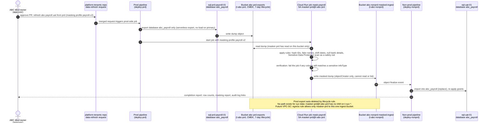

- [Mermaid source](09-prod-to-nonprod-data-flow.mmd) · [SVG export](rendered/09-prod-to-nonprod-data-flow.svg)

## 10-identity-access — Identity Access

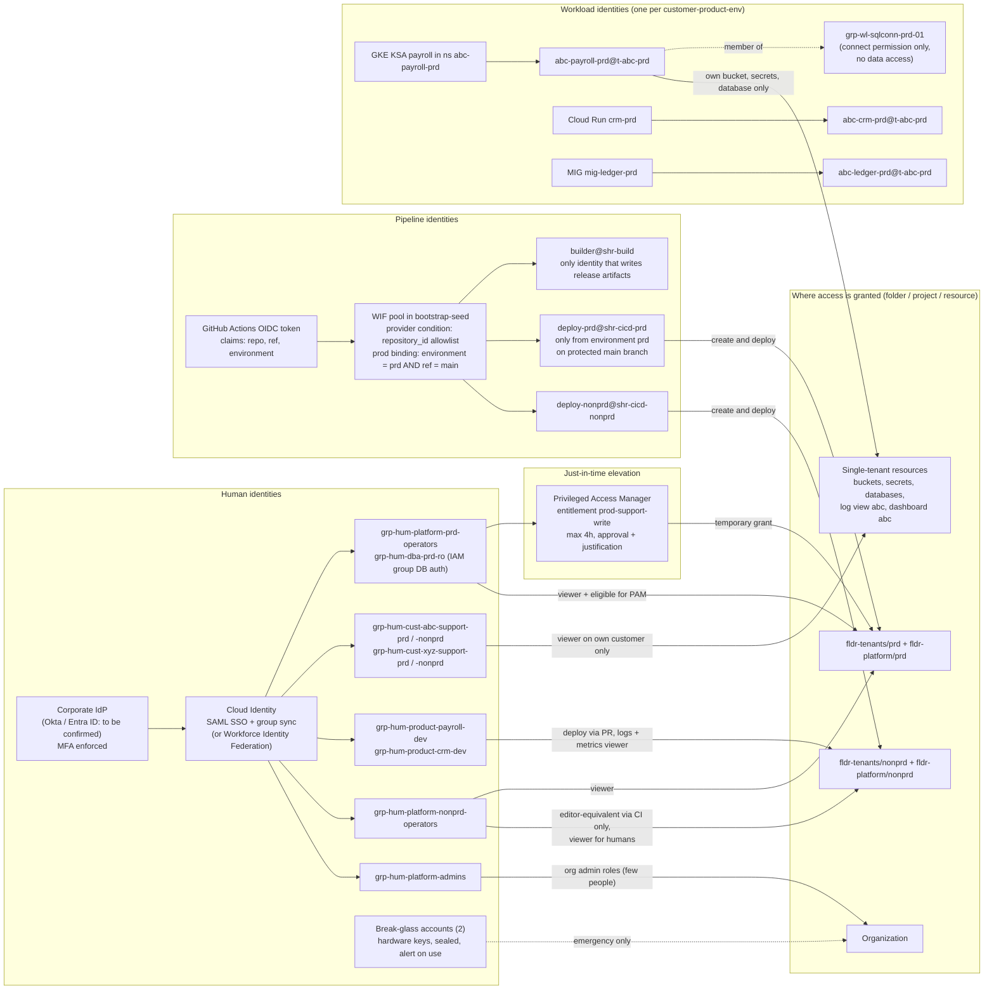

- [Mermaid source](10-identity-access.mmd) · [SVG export](rendered/10-identity-access.svg)

## 11-network-security — Network Security

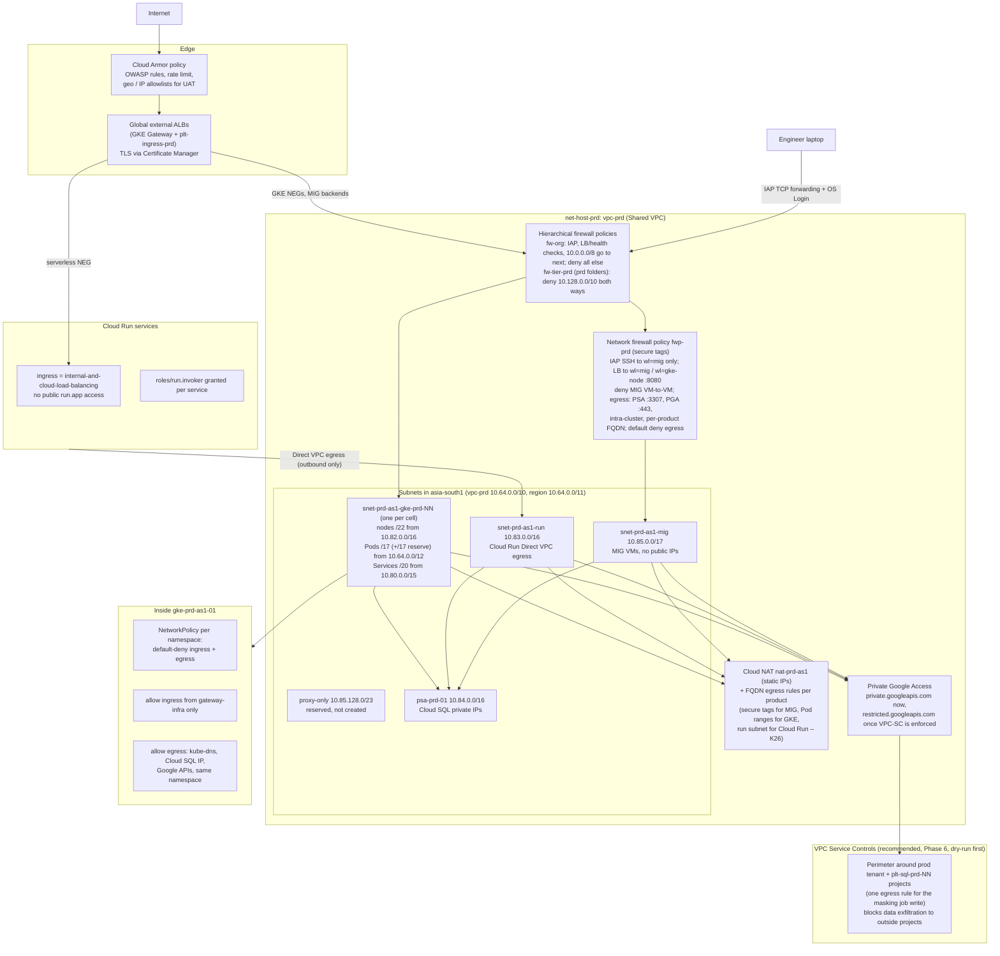

- [Mermaid source](11-network-security.mmd) · [SVG export](rendered/11-network-security.svg)

## 12-dr-topology — Dr Topology

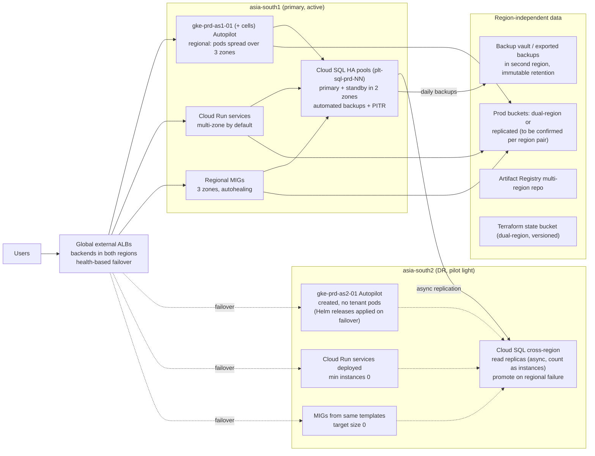

- [Mermaid source](12-dr-topology.mmd) · [SVG export](rendered/12-dr-topology.svg)

## 13-mysql-privilege-model — Mysql Privilege Model

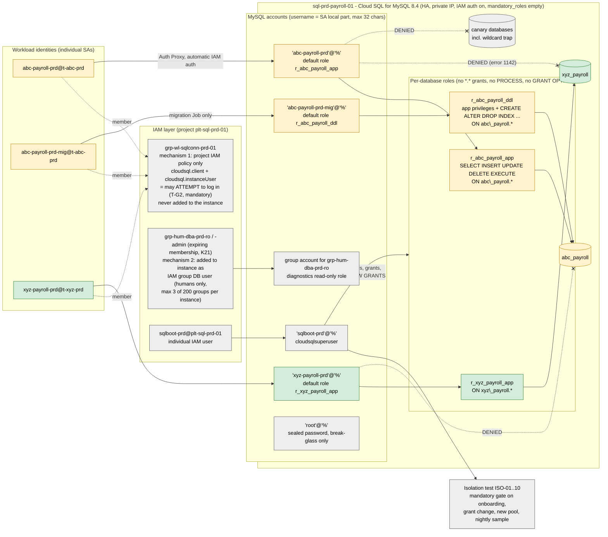

- [Mermaid source](13-mysql-privilege-model.mmd) · [SVG export](rendered/13-mysql-privilege-model.svg)
