# Architecture: Multi-Tenant, Multi-Product GCP Platform

## 1. Problem summary

| Dimension | Scale |
|---|---|
| Products | 15–20, each on one of three runtimes: **GKE**, **Cloud Run**, **Managed Instance Groups (MIG)** |
| Customers | 200+ |
| Environments per customer | 4: `dev`, `stage`, `uat`, `prod` |
| Tenancy | One customer runs several products inside the **same** customer infrastructure/project |
| Version divergence | Customers run the same product at different versions, with customer-specific customizations |
| Data sharing | Allowed **between one customer's own environments**, never across customers |
| Shared infra | GitHub/Bitbucket runners, Ansible runners |

Steady-state footprint: 200 customers × 4 envs = **800 environment projects** plus 200 customer data projects. Adding a customer, product or version should therefore be a **config change**, not new code.

## 2. Design principles

1. **The customer is the isolation boundary.** Products of one customer share a project per environment. Customers never share a project, IAM binding, KMS key, VPC-SC perimeter or data store.
2. **Environment is the policy boundary.** Org policies, network, budgets and access differ by environment (prod vs non-prod). They're enforced through Resource Manager **tags**, which avoids copying folder trees.
3. **Pool compute, silo data.** Expensive control planes (GKE clusters, load-balancer IPs, runners) are pooled where it's safe. Data, identities and keys are always per customer.
4. **Everything is declarative and config-driven.** One YAML file per *customer × environment × product* is the deployable unit. Terraform, Argo CD and the CI pipelines read the same files.
5. **Small blast radius.** Terraform state is split per customer and environment. A bad change touches one customer-env, never all 800.
6. **No long-lived keys.** CI uses Workload Identity Federation (OIDC), and workloads use Workload Identity or attached service accounts.

## 3. Resource hierarchy



```
Organization (example.com)
├── fldr-platform                     shared, owned by platform team
│   ├── mtp-seed                      Terraform state, seed SA
│   ├── mtp-cicd-nonprod              non-prod GitHub/Bitbucket + Ansible runners
│   ├── mtp-cicd-prod                 prod runners, WIF pool, Argo CD management cluster
│   ├── mtp-artifacts                 Artifact Registry (images, Helm OCI charts), golden VM images
│   └── mtp-observability             central log buckets, metrics scope, alerting
├── fldr-network
│   ├── mtp-net-dev                   Shared VPC host (one per environment)
│   ├── mtp-net-stage
│   ├── mtp-net-uat
│   └── mtp-net-prod
├── fldr-compute
│   ├── mtp-gke-dev                   pooled multi-tenant GKE clusters per environment
│   ├── mtp-gke-stage
│   ├── mtp-gke-uat
│   └── mtp-gke-prod
└── fldr-tenants
    ├── fldr-acme                     one folder per customer
    │   ├── mtp-acme-dev              all of Acme's products in dev
    │   ├── mtp-acme-stage
    │   ├── mtp-acme-uat
    │   ├── mtp-acme-prod
    │   └── mtp-acme-data             cross-environment shared data for Acme only
    └── fldr-globex ...
```

**Why customer-first folders (not environment-first)?** Customer-first keeps everything a customer owns under one node. That's where customer IAM (support groups, customer admins), the VPC-SC perimeter, billing export labels and offboarding all live. Environment-specific controls come from an `env` **tag** (`dev|stage|uat|prod`) bound to every project. Org policies are then conditioned on the tag, for example `resource.matchTag('<org>/env', 'prod')`. Conditioning on the tag gives environment-specific policy without duplicating 200 folders four times.

**Naming**: `mtp-<customer>-<env>`. Customer slugs are at most 12 characters, so project IDs stay under the 30-character limit. Labels on every resource: `customer`, `env`, `product`, `cost-center`.

## 4. Tenancy model

| Layer | Isolation | Notes |
|---|---|---|
| Project | **Per customer per env** | Holds Cloud Run services, MIGs, product service accounts, datastores, and the dedicated GKE cluster if the customer is on the dedicated tier |
| Network | Shared VPC **per env**; one **/22 subnet per customer-env** | Firewalls are keyed on per-customer network tags and service accounts |
| GKE | **Pooled** (default) or **dedicated** per customer-env | Pooled: namespace per customer on a shared cluster. Dedicated: a cluster inside the customer project (large or regulated customers, usually prod only) |
| Identity | One GSA per product per customer-env (`<product>-sa@mtp-<customer>-<env>`) | GKE pods map to it via Workload Identity; Cloud Run and MIG attach it directly |
| Data | Per customer-env stores plus a per-customer data project | CMEK key ring per customer (crypto-shredding on offboarding) |
| Perimeter | One VPC Service Controls perimeter per customer | Wraps the customer's four env projects and its data project |

### Tiering

The `tier` field in `tenant.yaml` selects pooled or dedicated GKE **per environment**. For example, Acme runs pooled in dev/stage/uat and dedicated in prod. Cloud Run and MIG workloads always run in the customer project because they have no shared control plane to pool.

Pooled clusters are **sharded**: roughly 40–60 customers per cluster per environment (`gke-prod-pool-01`, `-02`, …). This keeps namespace count, node-pool churn and upgrade blast radius bounded. Shard assignment is an explicit field, so customers can be moved deliberately.

## 5. Networking

* **Shared VPC host per environment** (`mtp-net-<env>`). Each env gets a non-overlapping /12 supernet:

  | Env | Tenant supernet | Pooled GKE nodes | Notes |
  |---|---|---|---|
  | dev | `10.16.0.0/12` | `10.0.0.0/20` | |
  | stage | `10.32.0.0/12` | `10.0.16.0/20` | |
  | uat | `10.48.0.0/12` | `10.0.32.0/20` | |
  | prod | `10.64.0.0/12` | `10.0.48.0/20` | |

  Each customer gets a deterministic **/22** (`cidrsubnet(env_supernet, 10, subnet_index)`), which allows 1,024 customers per env. Acme (`subnet_index: 1`) is `10.64.4.0/22` in prod and `10.16.4.0/22` in dev.
* **GKE IP plan** (secondary ranges only need to be unique within one env's VPC):

  | Range | Pooled shard *n* (0–6; 7 = platform mgmt cluster) | Dedicated cluster *i* (0–31) |
  |---|---|---|
  | Pods | `cidrsubnet(100.64.0.0/11, 3, n)` → /14 | `cidrsubnet(100.96.0.0/11, 5, i)` → /16 |
  | Services | `cidrsubnet(10.240.0.0/12, 8, n)` → /20 | `cidrsubnet(10.240.0.0/12, 8, 16+i)` → /20 |
  | Control plane | `cidrsubnet(172.16.0.0/16, 12, n)` → /28 | `cidrsubnet(172.16.0.0/16, 12, 16+i)` → /28 |

  Pod ranges come from RFC 6598 (`100.64.0.0/10`), so they don't consume RFC 1918 space.
* **Egress** through Cloud NAT per host VPC, with **Private Google Access** on all subnets. No public IPs on VMs or nodes, enforced by the org policy `compute.vmExternalIpAccess`.
* **Ingress**: one global external Application Load Balancer **per customer-env** fronts that customer's Cloud Run and MIG products, using host-based routing (`<product>.<customer>.<env>.example.com`) and Cloud Armor. GKE products use the **Gateway API** on each cluster, with per-customer `HTTPRoute`s.
* **Isolation inside the shared VPC**: default-deny firewall policies. Allow rules are keyed on target service accounts, so `acme` workloads can't reach `globex` subnets. In GKE, a namespace-level `NetworkPolicy` enforces the same rule (Dataplane V2).
* **Scaling the host**: Shared VPC attachment and subnet quotas get raised up front. The design also allows sharding a host (`mtp-net-prod-01`, `-02`) per block of customers without changing tenant code, because the host project is looked up per customer.

## 6. Runtime patterns

### 6.1 Cloud Run → [diagram](diagrams/cloud-run.svg)
* One Cloud Run v2 service per product in the customer-env project, with ingress set to `internal-and-cloud-load-balancing`.
* A serverless NEG feeds the customer's ALB, with Cloud Armor and managed certificates.
* **Direct VPC egress** into the customer's /22 reaches private datastores (Cloud SQL private IP, Memorystore).
* Revisions are labelled with `version`. Traffic splitting gives canary rollouts per customer.

### 6.2 GKE → [diagram](diagrams/gke.svg)
* Private, regional GKE Standard clusters with Dataplane V2, Workload Identity, Gateway API, Binary Authorization, Shielded nodes and the release channel `REGULAR` (`STABLE` for prod).
* **Pooled**: namespace `<customer>`. The `tenant-namespace` chart applies ResourceQuota, LimitRange, default-deny NetworkPolicy and RBAC.
* **Dedicated**: the same chart runs on a cluster inside `mtp-<customer>-<env>`, with optional dedicated node pools that use taints.
* Deployments use **Argo CD ApplicationSets** that watch `config/tenants/*/*/*.yaml`. Each file becomes one Argo Application, which renders the `product-service` Helm chart with layered values.

### 6.3 Managed Instance Groups → [diagram](diagrams/mig.svg)
* For legacy or stateful products that can't be containerised.
* Images are baked by Packer plus Ansible on the shared Ansible runners: one **golden image per product version** in `mtp-artifacts`.
* A regional MIG per product in the customer-env project uses health checks, autohealing and an autoscaler. Rolling updates use `max_surge=3, max_unavailable=0`.
* Customer-specific configuration is pushed at boot from Secret Manager and instance metadata. Ansible runners reach instances only via IAP, with no public SSH.

## 7. Version divergence and customer customization

### 7.1 Source of truth

```
config/
├── catalog/products.yaml               product → runtime, image repo, supported versions, chart version
└── tenants/
    └── acme/
        ├── tenant.yaml                 identity, tier, network index, data-sharing rules, budgets
        ├── dev/orders.yaml             ← one file per customer × env × product
        ├── prod/orders.yaml
        └── prod/notify.yaml
```

Each release file holds the version pin plus that customer-env's overrides:

```yaml
# config/tenants/acme/prod/orders.yaml
customer: acme
env: prod
product: orders
runtime: gke
cluster: acme-prod-dedicated
version: "3.1.4"
chartVersion: "1.4.0"
replicaCount: 4
featureFlags:
  bulkImport: true
```

* **Different customers, different versions**: `acme/prod/orders.yaml` pins `3.1.4`, while `globex/prod/orders.yaml` pins `2.9.1-globex.2`.
* **Promotion** is a pull request that bumps `version` in the next environment's file (dev → stage → uat → prod). CI gates check that the version exists in the catalog and is still supported, and that the previous environment has run it successfully.
* **Support window**: the catalog lists `supported` versions (N-2 policy). CI fails if a customer is pinned to an unsupported version, which creates upgrade pressure without forcing big-bang upgrades.

### 7.2 Customization ladder (prefer the lowest rung)

1. **Configuration and feature flags.** Per-customer values in the release file go into ConfigMaps, Cloud Run env vars or MIG metadata.
2. **Helm value overrides.** Resources, replicas, sidecars and extra env, all layered as `chart defaults < products/<product>.yaml < env/<env>.yaml < tenants/<customer>/<env>/<product>.yaml`.
3. **Extension points.** Customer plugins and hooks are loaded at runtime from a customer bucket or image layer.
4. **Customer patch build (last resort).** A short-lived branch `customer/globex/2.9` produces `2.9.1-globex.2`. It's tracked as technical debt with an expiry date and merged upstream or dropped at the next major version.

The same product chart and the same Terraform modules serve every version. Divergence lives only in data (versions and values), never in forked infrastructure code.

## 8. Data sharing between a customer's own environments



* Every customer-env project owns its operational stores (Cloud SQL, GCS, Firestore, Memorystore). Products of the same customer-env may share these stores.
* A **customer data project** (`mtp-<customer>-data`) is the only place cross-environment sharing happens:
  * `raw_prod`: the BigQuery dataset and GCS bucket exported from prod. By default only prod identities can read it.
  * `masked`: produced by a scheduled de-identification job (Cloud DLP / Sensitive Data Protection). It's readable by `dev`, `stage` and `uat`.
  * `shared_reference`: reference and master data that is readable by all four envs.
* Who can read what is declared in `tenant.yaml`:
  ```yaml
  data_sharing:
    masked_from_prod_to: [dev, stage, uat]
    raw_from_prod_to: [uat]        # opt-in, only where the customer contract allows
  ```
  Terraform turns this into dataset- and bucket-level IAM for that customer's product service accounts **only**.
* **Guardrails that make cross-customer leakage structurally impossible**:
  * A **VPC-SC perimeter per customer** wraps its 5 projects and restricts BigQuery, GCS, Cloud SQL, Secret Manager and KMS. Data can't be copied to another customer's project even with a mistaken IAM grant.
  * A **CMEK key ring per customer** lives in the data project. Deleting the key crypto-shreds the customer's data on offboarding.
  * An org policy restricts IAM members to the company domain and service accounts. Terraform modules only accept the identities of the same customer.

## 9. Shared platform services

| Service | Project | Notes |
|---|---|---|
| GitHub Actions / Bitbucket Pipelines runners | `mtp-cicd-nonprod`, `mtp-cicd-prod` | Autoscaled private MIGs of ephemeral runners. Prod and non-prod are separate projects (a service project attaches to only one Shared VPC host, and it keeps prod credentials off non-prod runners). |
| CI auth | `mtp-cicd-prod` | **Workload Identity Federation**: GitHub OIDC (`token.actions.githubusercontent.com`) and Bitbucket OIDC. Attribute conditions lock it to the org's repositories, with no JSON keys. |
| Ansible runners | `mtp-cicd-nonprod`, `mtp-cicd-prod` | Private MIG. Used by Packer image bakes and day-2 configuration of MIG products, reaching instances via IAP TCP forwarding. |
| Artifact Registry | `mtp-artifacts` | Docker images, Helm charts (OCI), golden images. Images are pinned by digest, Binary Authorization attestations are made at build time, and cleanup policies apply. |
| Argo CD | `mtp-cicd-prod` (`mgmt-argocd` cluster) | ApplicationSets generate one Application per GKE release file. Clusters are reached through GKE Fleet Connect Gateway, so no network peering is needed. One AppProject per env restricts prod apps to prod clusters. |
| Terraform state | `mtp-seed` | GCS bucket with versioning. Prefix `tenants/<customer>/<env>` gives per-tenant state and locking. |
| Observability | `mtp-observability` | Aggregated log sinks with `customer` and `env` labels, a metrics scope across tenant projects, SLO alerting, and per-customer log views for support teams. |

## 10. Automation and delivery

```
terraform/stacks/
  0-bootstrap      seed project, state bucket, Terraform SA                  (once)
  1-org            folders, env tag key/values, org policies                  (rarely)
  2-networking     4 Shared VPC hosts, NAT, firewall policies                 (rarely)
  3-platform       CI/CD WIF, runners, Ansible runners, Artifact Registry     (rarely)
  4-gke-fleet      pooled GKE clusters per env                                (per shard)
  5-tenant-base    per customer: folder, data project, KMS, VPC-SC perimeter  (per customer)
  6-tenant-env     per customer × env: project, subnet, SAs, Cloud Run, MIG,
                   dedicated GKE, ALB, data-sharing IAM                       (per customer-env)
```

* **Onboarding a customer** means a PR adding `config/tenants/<customer>/` (see [onboarding.md](onboarding.md)). CI runs `5-tenant-base` and then `6-tenant-env` for the four envs as a matrix, and Argo CD picks up the GKE release files automatically. No code changes are needed.
* **Pipeline**: `validate` (fmt, validate, tflint, checkov, helm lint, kubeconform, `tools/validate_config.py`) → `plan` for each changed **non-prod** customer-env on the PR (`tools/changed_tenants.py` computes the minimal matrix) → `apply` after merge. Prod is planned and applied only inside the protected `prod` GitHub environment (required reviewers), on prod runners. That's the only place the `tf-prod` identity can be obtained through WIF.
* **Drift**: a nightly `plan` across all states reports drift to the platform channel.

## 11. Security baseline

* Org policies: no service-account keys, no external VM IPs, restricted resource locations, uniform bucket-level access, required Shielded VMs, domain-restricted sharing, OS Login.
* Workload Identity everywhere, with one GSA per product per customer-env. Its permissions are scoped to the customer's own projects only.
* Binary Authorization on GKE allows only images signed by the CI attestor.
* Secrets live in Secret Manager in the customer project. GKE reads them through the Secret Manager CSI driver or External Secrets, scoped by Workload Identity.
* Audit logs (Data Access for prod) go to a locked log bucket in `mtp-observability`.

## 12. Scalability, cost and operations

| Concern | Approach |
|---|---|
| ~1,000 projects | Project-creation quota raised. Projects are created by Terraform through the seed SA. Per-tenant state keeps each plan small. |
| GKE cost | Pooled clusters per env shard instead of ~800 clusters. Dedicated clusters only where a contract requires them. Cluster autoscaler, spot node pools for dev/stage. |
| Cost attribution | Labels plus one project per customer-env make billing export → BigQuery → per-customer cost straightforward. Budgets per customer-env come from `tenant.yaml`. |
| Upgrades | GKE release channels with maintenance windows per env. Pooled shards are upgraded in waves (dev → stage → uat → prod). |
| Offboarding | Remove the tenant directory. A destroy plan per env runs, then the CMEK key is destroyed and the folder deleted. |
| DR | Prod clusters are regional. Cloud SQL HA with cross-region replicas for tier-1 customers, plus GCS dual-region buckets. Terraform can rebuild any customer-env in a second region by changing `region`. |

## 13. Key decisions and trade-offs

| Decision | Alternative | Why this choice |
|---|---|---|
| Project per customer-env, products share it | Project per product per customer | 4× fewer projects (800 vs ~12,000), and it matches the "multi-product in the same project" requirement. Product isolation comes from per-product SAs. |
| Pooled GKE with a dedicated option | Cluster per customer-env | ~800 control planes is too costly to run and upgrade. Namespaces plus NetworkPolicy, quotas and WI give enough isolation for most customers. |
| Shared VPC per env | VPC per customer with peering or NCC | Central network control, no peering limits, simpler IP planning. Isolation is enforced by firewall policies, SA-scoped rules and VPC-SC. |
| Release file per customer-env-product | Long-lived env branches, or values duplicated per runtime | One reviewable diff per promotion, the same file feeds Terraform and Argo CD, and drift between runtimes is impossible. |
| Tags for environment policy | Environment-first folder tree | Avoids 4× folder duplication while keeping customer-level ownership. |
