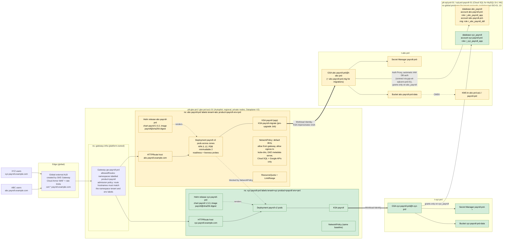
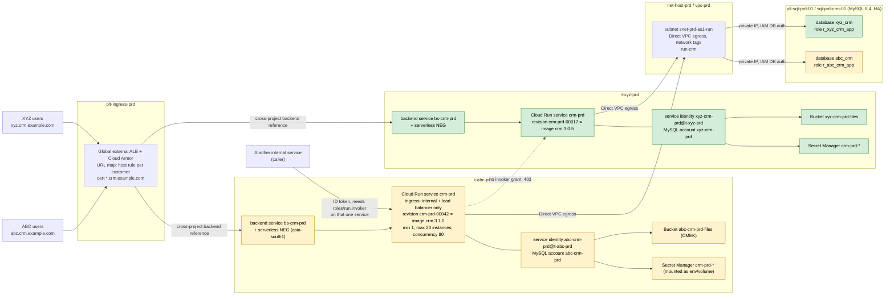
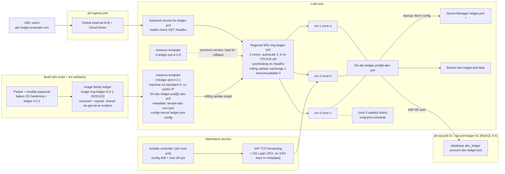

# Multi-Tenant GCP Platform – Architecture Overview

## 1. Problem and design goals

The platform hosts 15–20 products for 200+ customers across Dev, Stage, UAT and Prod. Products may run on GKE, Cloud Run or Compute Engine Managed Instance Groups (MIGs). Customers may subscribe to multiple products, run different product versions and apply customer-specific configuration.

The design aims to:

- isolate customer workloads and data;
- support all four environments and controlled data movement between a customer's own environments;
- allow product versions to differ by customer where the deployment model supports it;
- reuse platform services and automation without giving customers direct GCP administration access;
- scale by adding customers and capacity cells rather than redesigning the platform.

## 2. Tenancy and environment model

The recommended model is hybrid:

- Each customer has a **non-production project** for Dev, Stage and UAT, and a separate **production project**.
- Shared platform projects provide centrally managed services such as networking, GKE clusters, ingress, build artifacts and observability.
- GKE workloads use customer/product/environment namespaces on shared regional clusters. Cloud Run services and MIGs run in the appropriate customer project for Dedicated deployments.
- Customer data and workload identities remain customer-scoped for Dedicated deployments. Shared services are granted only the access they need.

This avoids creating a separate GCP project for every product/environment combination while retaining a meaningful production boundary for each customer.

## 3. Product deployment models

The product catalogue declares one of three deployment models:

| Model | Deployment pattern | Version handling | Isolation boundary |
|---|---|---|---|
| Dedicated (default) | Separate customer deployment | Each customer can run its own version | Platform / infrastructure boundary |
| Shared | One product deployment serves multiple customers | One common version; customer differences use configuration or feature flags | Application logic |
| Cohort | One deployment per version cohort | Customers in different cohorts can run different versions | Application logic within each cohort |

Dedicated is the default because it provides the clearest isolation. Shared and Cohort are options only where the product is designed and reviewed for application-level tenant isolation. This trade-off is explicit: a shared product identity can access the customer databases assigned to that shared deployment, so application code must enforce tenant separation.

## 4. Runtime architectures

The assignment asks for one architecture diagram per runtime. These are the three primary runtime diagrams:

### GKE

GKE provides shared regional clusters with separate namespaces and Helm releases. Customer-specific service accounts, secrets, storage and database grants are used for Dedicated workloads. Network policies and namespace controls limit workload communication.

### Cloud Run

Cloud Run services are deployed per customer for Dedicated products. A shared external load balancer routes customer hostnames to the correct service. Services use customer-scoped identities and private connectivity to required data services.

### Compute Engine MIG

MIG products use versioned machine images built with Packer and Ansible. Regional managed instance groups provide rolling updates, health checks and autoscaling. Instances use customer-scoped service accounts and private access to data services.

## 5. Version divergence and customer customisation

A tenant/product subscription is represented in the registry. For Dedicated deployments, the subscription records the version and configuration for each environment. The same product can therefore run version 2.x for one customer and 1.x for another. Shared deployments use a common product version with customer-specific configuration; Cohort deployments assign customers to a version cohort.

Changes are promoted through Dev → Stage → UAT → Prod. Environment-specific configuration is kept separate from the product image or chart, and deployed artifacts are versioned and immutable.

## 6. Data isolation and controlled sharing

For Dedicated deployments, each customer has a separate database/schema boundary, workload identity and scoped grants. Shared or Cohort products retain a database per customer but use a shared product identity for the databases served by that deployment; tenant isolation is therefore enforced by the product application and must be tested by the product team.

Data movement is controlled and limited to the same customer's environments. Production data is not copied directly into lower environments as-is; the designed flow uses an approved, masked or sanitised dataset. There is no cross-customer data sharing in the design.

## 7. Infrastructure and application automation

- **Terraform** provisions GCP foundations and runtime infrastructure, including projects, networking, platform services and tenant resources.
- **Helm** packages and deploys GKE applications. It consumes the release configuration produced from the tenant/product registry; it does not own shared cluster foundations.
- **CI/CD workflows** validate changes, plan and apply infrastructure, build and scan artifacts, promote releases, and run deployment checks. GitHub Actions is used for the reference workflow implementation; the design can be adapted to Bitbucket.
- **Ansible** supports configuration and day-2 operations for MIG-based products. Shared runners are centrally managed and use scoped identities.

## 8. Repository validation and limitations

The repository includes Terraform modules and stacks, Helm charts, Ansible playbooks, registry examples, workflow definitions, diagrams, documentation and local automated checks.

The implementation has been checked locally. **It has not been deployed to or tested in a GCP organisation.** Terraform plans/applies, real Cloud SQL isolation tests, live GitHub/Bitbucket workflow execution, and runtime deployment/rollback tests remain validation steps. Cost figures and service-level targets are design assumptions for assessment purposes, not confirmed commercial commitments.

## 9. Further technical references

The following documents provide implementation detail if required; they are supporting references rather than prerequisites for understanding the design:

- [Terraform and Helm implementation](stage-5-6-terraform-helm.md)
- [CI/CD, cost, SLO and DR details](stage-7-8-cicd-cost-slo.md)
- [Security implementation](stage-3-security-implementation.md)
- [Networking implementation](stage-4-networking.md)
- [Assumptions and open questions](assumptions-and-open-questions.md)
- [Requirements traceability](requirements-traceability.md)
- [Prompts log](prompts-log.md)
