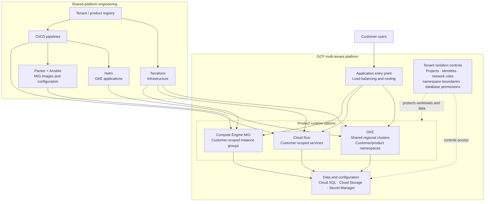
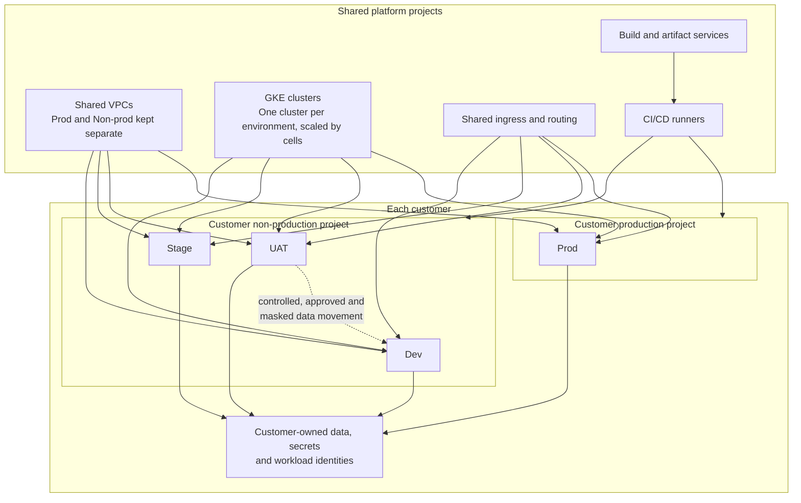
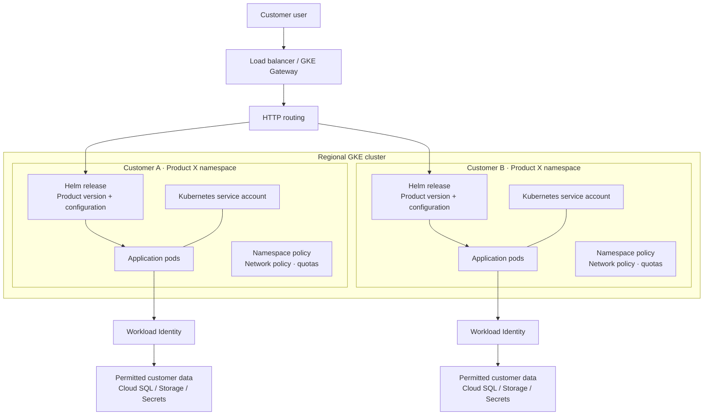
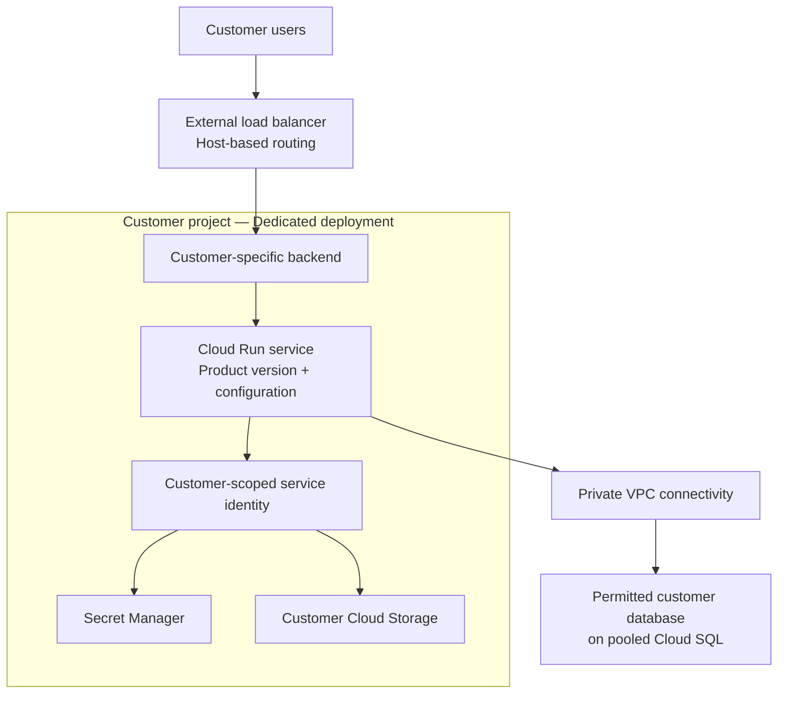
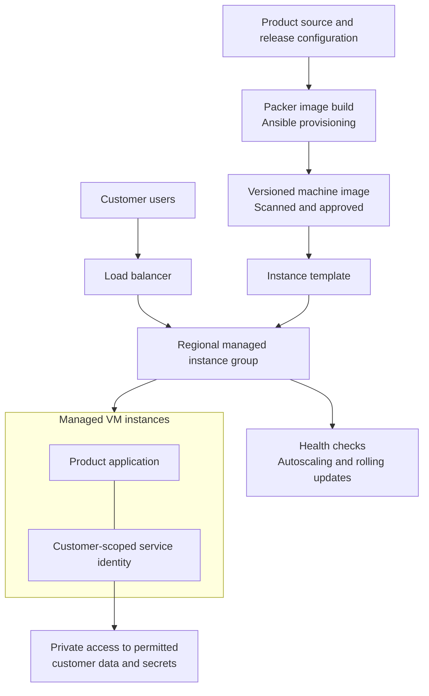
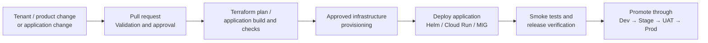

# Multi-Tenant GCP Platform — Architecture Overview

> **Start here:** this document explains the proposed architecture at a conceptual level. It focuses on the decisions that answer the assignment. Detailed implementation documents, Terraform modules, Helm charts and supporting diagrams are linked at the end.

## 1. What we are building

A GCP platform for **15–20 products and 200+ customers**, with four environments (Dev, Stage, UAT and Prod). A customer can subscribe to several products. Products can run on GKE, Cloud Run or Compute Engine Managed Instance Groups (MIGs), and different customers may run different product versions and configurations.

The design uses shared platform services where reuse is useful, while keeping customer production boundaries, workload identities and data access separate.

## 2. Overall architecture

This is the main view of the platform. It shows how users reach products, where the three runtime options sit, where customer data lives, and how the platform is delivered.

**How to read it:** users reach a product through the common entry layer. The product runs on one of the three supported runtimes. Each runtime accesses only the data and configuration permitted to its workload identity. Terraform provisions infrastructure; CI/CD coordinates releases; Helm deploys GKE applications; Packer and Ansible prepare and configure MIG instances.

## 3. Customer and environment model

The design uses a **hybrid project model**:

- Each customer has a separate **production project** and a separate **non-production project**.
- Dev, Stage and UAT are separated as environments within the non-production tier; Prod is isolated in the production tier.
- Shared platform projects host common networking, GKE clusters, ingress, build/artifact services and deployment runners.
- Cloud SQL instances can be pooled, while each customer/product receives its own database and database permissions.

The data movement shown is an example of controlled sharing between a customer's own environments, not unrestricted replication. Production data is not copied into non-production without the required masking and approval controls.

## 4. Product deployment models

The product registry defines how each customer subscription is deployed.

| Model | How it works | Version handling | Isolation approach |
|---|---|---|---|
| **Dedicated (default)** | A separate deployment for each customer | Each customer can use its own version and configuration | Stronger infrastructure and identity separation |
| **Shared** | One product deployment serves multiple customers | One common product version; customer-specific configuration where supported | Application-level tenant isolation |
| **Cohort** | Customers are grouped into deployments | Different cohorts can run different product versions | Application-level isolation within each cohort |

Dedicated is the default because it provides the clearest isolation. Shared and Cohort are used only for products designed and reviewed for application-level tenant isolation. A shared workload identity can access the customer databases assigned to that deployment, so the application must enforce tenant separation.

## 5. Runtime architectures

These diagrams intentionally show the main components and flow, not individual resource names or configuration values.

### 5.1 GKE

**Approach:** regional GKE clusters are shared by default. Each customer/product/environment gets a namespace and Helm release. Workload Identity maps Kubernetes service accounts to Google service accounts. Namespace controls and network policies limit workload interaction; customer-specific IAM and database grants control data access. Dedicated customers can use a dedicated cluster where required by their isolation tier.

### 5.2 Cloud Run

**Approach:** Dedicated Cloud Run services run in the customer's project. A shared load-balancing layer routes each customer hostname to the correct backend. Each service uses its customer-scoped identity and private connectivity to reach only its permitted data services.

### 5.3 Compute Engine Managed Instance Groups (MIG)

**Approach:** Packer and Ansible create versioned machine images. A versioned instance template defines the MIG deployment. Regional MIGs provide health checks, autoscaling and rolling updates. Instances use customer-scoped identities and private access to permitted data services.

## 6. Version divergence and customer customisation

A customer/product subscription records its runtime, deployment model, version and environment-specific configuration in the registry. For Dedicated deployments, each customer can be upgraded independently. Shared deployments use a common product version, while Cohort deployments allow different versions between cohorts. Customer-specific settings are supplied as configuration rather than separate product code wherever possible.

## 7. Data isolation and environment sharing

- Dedicated workloads use customer-scoped identities, storage and database permissions.
- Cloud SQL can be pooled at the infrastructure level, but customer/product databases and grants remain separate.
- Shared and Cohort workloads use application-level tenant isolation; this is a deliberate trade-off, not database-level identity isolation.
- Data sharing between Dev, Stage, UAT and Prod is controlled. Non-production copies of production data must be masked and approved.

## 8. How infrastructure and releases are automated

Terraform manages GCP infrastructure. Helm manages GKE application releases. Cloud Run and MIG application releases are handled by the delivery workflows. GitHub/Bitbucket and Ansible runners are shared platform services, with separate production and non-production deployment identities and approval gates.

## 9. Further implementation detail

The following documents are supporting references; they are not required to understand the high-level design:

| Topic | Detail |
|---|---|
| [Runtime and platform diagrams](../diagrams/README.md) | All architecture diagrams, including detailed implementation views |
| [Terraform and Helm](stage-5-6-terraform-helm.md) | Infrastructure modules, stack layout and chart responsibilities |
| [CI/CD, cost and SLOs](stage-7-8-cicd-cost-slo.md) | Delivery workflows, capacity, cost assumptions, monitoring and DR |
| [Security implementation](stage-3-security-implementation.md) | IAM, policy, secrets, audit and Kubernetes controls |
| [Networking](stage-4-networking.md) | Shared VPC, segmentation, routing and ingress |
| [Database architecture](database-architecture-mysql.md) | MySQL pools, customer databases and privilege model |
| [Assumptions and open questions](assumptions-and-open-questions.md) | Decisions that require confirmation before a real deployment |
| [Requirements traceability](requirements-traceability.md) | Where assignment requirements are addressed |
| [Prompts log](../PROMPTS.md) | AI-assisted workflow and prompt record |

## 10. Implementation and validation status

The repository contains proposed architecture, Terraform and Helm implementation, automation workflows, tests and documentation. Local validation is documented in the completion summary. **The platform has not been deployed or tested in a GCP organisation, and the CI/CD workflows have not been run against GCP.** Cloud-specific behaviour, permissions, quotas, cost assumptions and disaster-recovery timings therefore require validation before production use.
