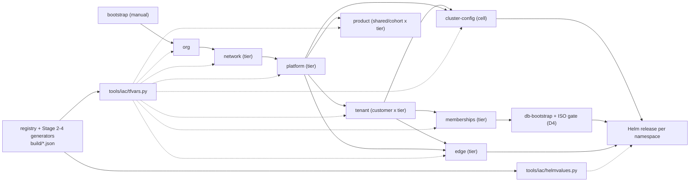

# Stages 5 and 6 – Terraform and Helm (consolidated)

Stage 5 (Terraform) provisions the GCP infrastructure, including the GKE clusters and the platform-owned Kubernetes objects. Stage 6 (Helm) deploys the applications on those clusters. Both consume the same generated plans (registry → Stages 2–4 → `build/*.json`), so neither contains per-customer data by hand.

**Status legend** as in Stages 3–4. **Nothing is GCP-tested**; no `terraform` or `helm` binary is available here.

| Component | Implemented | Locally tested | GCP validation |
|---|---|---|---|
| Terraform modules (18) and stacks (9) | ✅ | Static checks HC01–HC07 (scan, variables, module wiring, outputs, versions, forbidden content) | T-TF1, T-TF2 |
| Stack catalogue (`terraform/stacks.yaml`) | ✅ | SK01–SK05 (binding ownership, required IAM vs access matrix, apply order, identities) | T-TF3, T-TF6 |
| tfvars bridge (`tools/iac/tfvars.py`) | ✅ | Generated tfvars match every stack's variables (HC06); per-tenant isolation of inputs | T-TF2 |
| Helm library + payroll chart | ✅ | Rendered with Go `text/template` (`tools/helmrender`) for all 8 releases; D8 rules, schemas, negative cases | T-H1–T-H4 |
| Terraform → Helm contract (`interfaces/helm-release.schema.json`) | ✅ | Values validated; every `terraform:` source is a declared stack output | T-TF3 |
| Ansible layout for MIG products (`ansible/`) | ✅ | YAML, role wiring, handlers, Jinja2 templates rendered | T-AN1 |
| ABC/XYZ examples (`examples/`) | ✅ | Regenerated and compared in tests | – |

## 1. Responsibilities

| Concern | Terraform | Helm | Pipeline (Stage 7) |
|---|---|---|---|
| Org, folders, guardrails, identities, IAM, PAM, WIF, audit | org stack | – | – |
| Networks, firewall, DNS zones, NAT | network stack | – | – |
| GKE cells, Cloud SQL pools, keys, platform jobs, Binary Authorization | platform stack | – | runs db-bootstrap / isolation gate |
| Load balancers, certificates, Cloud Armor, DNS records | edge stack | – | – |
| Namespaces, KSAs, RBAC, NetworkPolicies, quotas, constraints, Gateways | cluster-config stack (Kubernetes provider) | – | – |
| Customer project resources (SAs, buckets, secrets containers, SQL users, Cloud Run shells, MIGs, backends) | tenant / product stacks | – | – |
| Application on GKE (Deployment, Service, HTTPRoute, HPA, PDB, ConfigMap, migration Job) | – | per-namespace release | resolves image digest, runs `helm upgrade` |
| Application version on Cloud Run / MIG | shell only (`ignore_changes` on image) | – | `gcloud run deploy`, Packer + Ansible (A-H-2) |
| Secret values | containers only | references only | added by product teams (D9) |

## 2. Dependencies and apply order

Onboarding a customer: **tenant → memberships → db-bootstrap + isolation gate → edge → cluster-config → Helm** (T-TF3). One state per stack instance; tenant states are per customer per tier, so a customer change never plans another customer's resources.

## 3. Interface Terraform → Helm

| Helm value | Producer |
|---|---|
| `image.repository` | org stack output `artifact_registry` |
| `image.digest` | pipeline: release-repository tag (registry version) → digest |
| `serviceAccount.name / migrationName` | cluster-config output `namespaces` (KSAs of the D8 baseline) |
| `route.gateway` | cluster-config output `gateways` |
| `route.hostnames` | registry hostname convention (N4 records) |
| `database.instanceConnectionName` | platform output `sql_connection_names` |
| `database.user / migrationUser` | tenant output `sql_users` |
| `secrets` (resource names only) | tenant output `secret_ids` |
| `buckets` | tenant output `bucket_names` |
| `config`, `env`, `tenant`, `product`, `image.version`, `isolation` | registry |

Values layering: chart `values.yaml` → `helm/environments/<env>.yaml` → generated release values. Customers influence only `config`, which renders as ConfigMap data and cannot inject objects (test).

## 4. Assignment coverage (sections 9 and 10)

- **Terraform:** modular and reusable; organisation, folders, projects, networking, GKE, Cloud Run, MIG (template, regional MIG, autoscaling, autohealing, rolling updates), Cloud SQL, IAM, secrets, KMS, buckets, load balancers, DNS, certificates, Cloud Armor, monitoring/audit; per-tier state, keyless CI identities, per-customer instantiation from the registry, prod/non-prod separation by stack instance and identity.
- **Ansible (MIG, Stage 2 §2C):** image bake playbook (run by Packer in `shr-build`), day-2 configuration over IAP + OS Login in batches, boot-time configuration as data from instance metadata set by Terraform; no customer data in images.
- **Helm:** chart per product on a shared library chart; per-environment values; per-customer values generated from the registry (version, config, hostnames, database, identity); probes, resources, HPA, PDB, rolling updates, migration hook, Pod Security `restricted`, images by digest; no infrastructure in charts.

## 5. Findings while implementing (no Stage 2–4 decision reopened)

| Item | Change |
|---|---|
| Stack permissions | Applying the stacks needs roles the access matrix did not yet grant (network admin on host projects, load balancer / certificate admin on ingress projects, org firewall policy admin, group creation, pool key rings). Added as explicit grants; SK02 keeps catalogue and matrix in sync. D3 checks still pass (270 bindings). |
| Certificates for Gateways | GKE Gateways need certificate maps in the cluster project, ALBs in the ingress project; both use DNS authorisation with per-project records (T-N10/T-TF1). |
| ConstraintTemplates | Constraints can only be planned after their templates exist → two-phase apply (R-TF-1). |

## 6. Outstanding GCP validation

T-TF1–T-TF6 and T-H1–T-H4 (register), together with the Stage 3–4 items they exercise (T-G2, T-M*, T-N*, T-S*, T-P*, T-A*). Suggested order: T-TF1 → T-TF2 for org/network/platform → T-TF5 (cluster-config) → T-TF3 with one tenant → T-H1–T-H4 → T-TF4.
