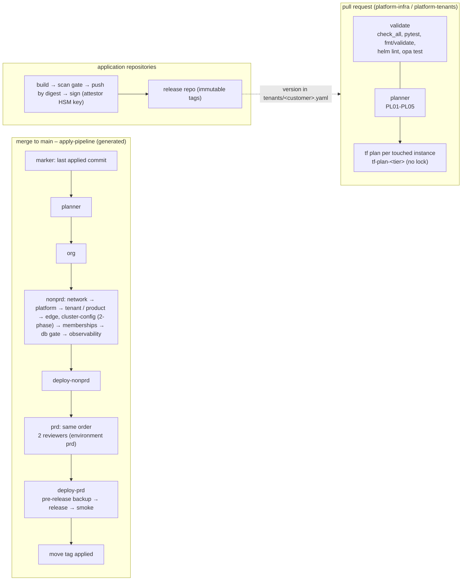

# Stages 7 and 8 – CI/CD, cost, capacity, SLOs and DR (consolidated)

Stage 7 turns the Stage 3 identities (D6), Stage 5 stacks and Stage 6 charts into pipelines. Stage 8 covers cost, capacity, service levels, monitoring, backup and DR on the same inputs. Both use the registry, Terraform stacks, charts, identities and controls of Stages 1–6. **No new product or service is introduced.** Two small corrections were made (K27, K28, §5), along with the IAM grants the new work needs (§5).

**Dependencies.** Stage 8 depends on Stage 7 at three points:
- **Capacity gate.** The capacity check (§2.4) runs as planner rule PL05 in every pull request.
- **Release mechanics behind the DR targets.** The pre-release backup and the automatic rollbacks (§1.4) are part of the DR targets.
- **New stack.** The `observability` stack is one more stack that the Stage 7 pipeline orders and applies.

Stage 7 uses Stage 8 only through PL05.

**Status legend:** ✅ implemented, 🧪 locally tested. GCP validation is the T-item that must pass in a test organisation. **Nothing in this document has run in GCP.** No GitHub workflow has run either, except `.github/workflows/ci.yml`, which needs no cloud access.

| Component | Implemented | Locally tested | GCP / GitHub validation |
|---|---|---|---|
| Pipeline planner `tools/cicd/planner.py` (PL01–PL05) | ✅ | 🧪 20 tests: affected instances, onboarding order, promotion, rollback, offboarding, capacity | T-CI3 |
| Reusable workflows (13) + composite action, `cicd/platform-workflows/` | ✅ | 🧪 CW01–CW09: identity gates per repository / trigger, least privilege, runners, pinning, rollback constructs | T-CI1, T-CI3–T-CI5 |
| Caller workflows (12) in 8 repositories, `cicd/repos/` | ✅ | 🧪 same, plus 12 negative tests | T-CI3 |
| Generated pipeline workflows (`apply-pipeline.yml`, `pr-pipeline.yml`) | ✅ | 🧪 CW08: job graph equals the stack catalogue | T-CI3 |
| `tools/cicd/tf.sh`, `tools/cicd/smoke.py`, drift CLI (`tools/monitoring/drift.py`) | ✅ | 🧪 smoke host names, export normalisation | T-CI4, T-CI6, T-A4 |
| CI of this repository, `.github/workflows/ci.yml` | ✅ | Runnable as is (no cloud identity) | – |
| Cost model `cost/cost-model.yaml` + `tools/cost/model.py` → [`cost-estimate.md`](cost-estimate.md) | ✅ | 🧪 CO01–CO04, 7 tests | T-CO1, T-CO2 |
| Capacity planning `tools/cost/capacity.py` (CP01–CP02, PL05) | ✅ | 🧪 3 tests | – |
| SLOs / monitoring `slo/slos.yaml` + `tools/slo/observability.py` (SL01–SL06) | ✅ | 🧪 7 tests (tests/test_slo.py) | T-SL1–T-SL6 |
| `observability` stack (Terraform) + uptime checks in the tenant stack | ✅ | HC01–HC07, SK01–SK05 | T-SL1, T-SL4, T-TF2 |
| Backup / DR `slo/dr.yaml` + `tools/slo/dr.py` (BC01–BC06); DR-replica option in `sql-pool` | ✅ | 🧪 6 tests (tests/test_slo.py) | T-DR1–T-DR5 |

---

## 1. Stage 7 – CI/CD

### 1.1 Repositories, identities and runners

One directory per repository from Stage 2 §1: `cicd/repos/<repo>/.github/workflows/`. Every job that holds a Google Cloud identity is defined in `platform-workflows` and called at `@v1`. This is what the WIF provider condition requires for `prd` (D6). CW04 also enforces it for `org`.

| Repository | Workflow (trigger) | Jobs → identity (environment, runner group) |
|---|---|---|
| `platform-infra` | `pr` (pull request) | validate (no identity) · planner · plans → `tf-plan-org` / `tf-plan-nonprd` / `tf-plan-prd` (`plan-*`, prd/nonprd runners) |
| | `apply` (push main) | org → `tf-org` (`org`); per tier the stacks → `tf-<tier>`, memberships → `groups-mgr-<tier>` (K28), db gate → `tf-<tier>` (`<tier>`) |
| | `drift` (nightly) | plans of every instance with `-detailed-exitcode` → `tf-plan-*`; DR01/DR02 exports → `tf-plan-org` |
| `platform-tenants` | `pr` | validate · planner (PL01 promotion, PL05 capacity) · plans → `tf-plan-<tier>` |
| | `apply` (push main) | per tier: tenant / product / edge / cluster-config / memberships / observability stacks → db gate → releases → `deploy-<tier>`; prd pre-release backup → `tf-prd` |
| `app-<product>` (×4) | `build` (main, tags `v*`) | test (no identity) · build-image → `builder` (build runners); MIG product also bake-vm-image |
| `platform-charts` | `release` (main) | build-chart → `builder` |
| `platform-ansible` | `pr`, `configure` (main, manual) | lint (no identity) · configure → `ansible-nonprd`, then `ansible-prd` |

All 13 WIF identities of D6 are used and every use is an allowed gate (CW03, CW09). GitHub-hosted runners only run jobs without a cloud identity. Jobs that hold an identity run on the self-hosted runner group of that identity's tier (CW06).

### 1.2 Pipelines

**Infrastructure provisioning.**
- **What runs.** The planner diffs the registry and the changed files against the last applied commit, which is held in the `applied` tag. A missed push can therefore never drop a change. It emits one matrix per job (`<stack>-<tier>`, `db-<tier>`, `deploy-<tier>`). Jobs with no work are skipped.
- **Order.** Job order follows `terraform/stacks.yaml` `after`. The nonprd tier always runs before prd, which is the infrastructure promotion. CW08 regenerates the pipeline from the catalogue, so a new stack (here `observability`) is ordered automatically.
- **Concurrency.** Each state has its own non-cancelling concurrency group. The GCS state lock covers the two repositories (R-S7-1).
- **Two-phase apply.** `cluster-config` is applied in two phases: ConstraintTemplates first, then the rest (R-TF-1).

**Application builds and security checks.** Images are built only from `main` (snapshot repository, dev only, nonprd Binary Authorization in dry-run) and from `v*` tags (release repository, immutable tags).
- **Scan gate.** The build fails on any CRITICAL vulnerability that has a fix (Artifact Analysis). Only then does `builder` sign the digest with the HSM attestor key. Binary Authorization in prd admits only those images (D9).
- **Charts and VM images.** Helm charts are published once per version. MIG images are baked by Packer + Ansible in `shr-build` (`ansible/packer/product.pkr.hcl`).
- **PR checks.**
  - The full local suite runs on every PR: registry rules, isolation cases, policy checks, HCL checks and Rego tests.
  - `terraform validate`, `helm lint` and `opa test` run in the pipeline (T-TF1, T-H1).

### 1.3 Promotion and self-service

**Promotion is a pull request on `platform-tenants/tenants/<customer>.yaml`.**
- **PL01.** A raised version at stg, uat or prd must equal what already runs in the previous environment of the same deployment. Rollback to an older supported version is allowed. A new deployment may not be newer than its own previous environment.
- **R08 / R09.** Unsupported or blocked versions are refused, and prd may not be newer than uat.
- **Approvals.** nonprd deploys follow one reviewer on the `nonprd` environment. prd follows two reviewers on `prd`, with no self-review.

**Self-service: Git-based (GitOps) versus a portal (assignment §11).**

| Criterion | Repository + PR workflow (chosen) | Portal (Backstage-style) |
|---|---|---|
| Audit trail and approval | Git history, CODEOWNERS, GitHub environments – already required by D6 | Must be built; still ends in Git or an API |
| Validation before change | Planner + D1 rules + plans in the PR | Same checks behind a form |
| Effort / new components | None – uses existing repos and runners | A new product to host, secure and run (scope expansion) |
| Usability for non-engineers | YAML edit in GitHub UI | Better |

The PR workflow is the self-service interface. A portal can later write the same tenant file through the GitHub API without changing the pipeline (B-item, not built).

### 1.4 Deployment and customer onboarding

| Runtime | Release | Automatic rollback | Migration |
|---|---|---|---|
| GKE | `helm upgrade --install --atomic --wait` with generated values + digest | Helm rollback on any failed hook / probe | pre-upgrade Job (Stage 6) |
| Cloud Run | new revision without traffic → 10 % canary + smoke test → 100 % | traffic back to the previous revision | pipeline-managed Cloud Run job `migrate-<service>` |
| MIG | regional template pinned to image `<product>-<X-Y-Z>`, rolling update (surge 3, unavailable 0) | previous template | first instance of the new version under a DB lock (A-S7-2) |

**Release safeguards.**
- **Pre-release backup.** Every prd release first takes an on-demand Cloud SQL backup of the pool (Stage 2 §6.6).
- **Smoke test.** A smoke test goes through the customer's public host name (DNS, certificate, Cloud Armor, LB, backend; `tools/cicd/smoke.py`).
- **Terraform and the MIG template.** Terraform ignores the MIG's running version (`ignore_changes = [version]`), so the pipeline owns it (A-H-2).

**Customer onboarding** means adding `tenants/<customer>.yaml` (`python3 -m tools.cicd.planner onboard <customer>` prints the sequence). Per tier, nonprd then prd:
1. Tenant project and resources.
2. Edge.
3. cluster-config (namespaces).
4. Memberships.
5. db-bootstrap.
6. Isolation gate (ISO-01..10).
7. Observability: SLOs, plus uptime checks in the tenant stack.
8. Releases of every environment.

A failing isolation test stops every release of that tier. **Offboarding** is never automatic (PL04). The runbook removes deletion protection under PAM and exports the data if the contract requires it. It then deletes the subscriptions, then the tenant file.

### 1.5 Failure handling – Terraform and CI/CD (assignment §13)

| Failure | Effect | Handling |
|---|---|---|
| Apply fails part-way | That state is partially applied; dependent jobs skip | Fix forward in a PR; re-run is idempotent (plan → apply); `applied` tag not moved, so the next run re-plans the same range |
| Two applies on one state (two repositories) | Second blocked by the GCS lock | Re-run after the first finishes (R-S7-1) |
| Stuck state lock | Applies of that state blocked | `terraform force-unlock` by a platform admin under PAM after checking no run is active |
| Release fails | Helm / Cloud Run / MIG roll back automatically; job fails | Fix version in the tenant file (rollback allowed by PL01) |
| Isolation gate fails | No release in that tier | Treated as a security incident (D4) |
| Drift detected | Nightly job fails (exit code 2), DR01/DR02 findings | Next apply restores the declared state, or the change is codified |
| Runner pool / GitHub outage | No pipeline runs | Break-glass: PAM-elevated admin runs `tools/cicd/tf.sh` from Cloud Shell with the same code (D7, audited by AL-BG-*) |
| WIF / environment misconfiguration | Auth denied | CW03 catches it before merge; nightly drift shows the failure |

---

## 2. Stage 8 – Cost, capacity and scaling

### 2.1 Cost estimate (indicative list prices – T-CO1)

Full tables: [`cost-estimate.md`](cost-estimate.md) (generated; CO04 keeps it current). Monthly totals in USD for 3 products per customer (Baseline):

| | 200 customers | 500 customers |
|---|---|---|
| List price / month | $130,727 | $301,689 |
| With 3-year commitments + office-hours non-prod | $84,837 | $197,057 |
| Per customer (list / optimised) | $654 / $424 | $603 / $394 |
| prd / nonprd / regional DR / shared | $77.3k / $38.0k / $14.1k / $1.2k | $179.2k / $91.7k / $29.4k / $1.4k |
| Range across 1–20 products per customer (list) | $44k – $785k | $116k – $1.97M |

How the estimate is built:
- **Source of counts.** The capacity model supplies the counts: subscriptions, GKE cells, Cloud SQL pools including DR replicas, and the MIG floor.
- **Inputs.** Sizing and usage are the illustrative values in `cost/cost-model.yaml`.
- **Scaling with products.** Cost is roughly linear in subscriptions, at about $200 per subscription per month at list price.
- **Unit cost.** Per customer it falls slightly from 200 to 500 customers at Baseline, as fixed platform costs are spread more widely.

### 2.2 Cost drivers and levers

| Driver (500 × Baseline) | Share | Lever |
|---|---|---|
| Cloud SQL pools (prd HA Enterprise Plus, uat HA) | 26 % | 3-year CUD (−52 % on prd compute); stop dev/stg instances out of hours; pool fill per capacity rule C1 |
| MIG floor (prd 3 VMs, nonprod 1 per environment) | 26 % | **Cohort/Shared model for MIG products** (R-S8-1); lower floors where availability allows (B10) |
| Autopilot pods | 17 % | Right-size requests (Q22); Flexible CUD; scale dev/stg to zero out of hours |
| Cloud Run | 11 % | min-instances only in prd; request billing elsewhere |
| Regional DR (replicas + empty cells) | 10 % | Business decision Q10 – shown separately so it can be priced per customer tier |
| Internet egress | 5 % | Usage-driven; CDN not in scope |

### 2.3 Cost attribution and idle management

- **Attribution.** Every project carries `tenant`, `product`, `env_tier` and `isolation_tier` labels (Stage 2 §0). GKE cost allocation is now on in every cell (`gke-cell` module), so namespace labels reach the billing data. Costs of shared Cloud SQL pools are split by each customer's database share (storage + connections), using the per-database metrics.
- **Billing export.** Billing export to BigQuery is set up in the Cloud Billing console, because Terraform cannot configure it (T-CO2). Per-customer reports are queries on that export.
- **Idle management.**
  - Out-of-hours scale-down of dev/stg is the office-hours lever. Cloud Run already scales to zero outside prd.
  - Pilot-light DR cells run no pods until promoted.
  - Unused snapshot images expire under an Artifact Registry cleanup policy (T-CO2).

### 2.4 Capacity planning and scaling

| Scales automatically | Mechanism |
|---|---|
| Pods / nodes | HPA (Stage 6) + Autopilot node provisioning |
| Cloud Run | instances 0 / min → max per service |
| MIG | autoscaler (CPU 60 %), autohealing |
| Cloud SQL storage | storage auto-increase; HA failover |

| Planned scale-out (platform PR) | Trigger (`cost/cost-model.yaml capacity`, warn 80 % / refuse 100 %) | Lead time |
|---|---|---|
| New GKE cell `gke-<env>-as1-NN` | namespaces per cell ≥ 800 of 1,000 | IP slot exists (N1); cluster + cluster-config ~1 h |
| New Cloud SQL pool / product-group split | tenants per pool ≥ 80 % of the effective cap (prd 40, non-prod 93) | ~30 min + bootstrap |
| New pool project `plt-sql-<tier>-NN` | instances per project ≥ 80 | minutes |
| New metrics scope `plt-obs-<tier>-NN` | monitored projects ≥ 300 of 375 | generated automatically by the observability plan |
| SLO service shard | SLOs per service ≥ 400 of 500 | generated automatically |
| Quotas (N5) | PA-QUOTA alert at 80 % | quota request: days |

`python3 -m tools.cost.capacity` prints current utilisation and due scale-outs. The planner refuses a placement that would exceed a limit (PL05), so a customer PR cannot overfill a cell or pool.

---

## 3. Stage 8 – Availability, monitoring, backup and DR

### 3.1 Targets and SLOs

| Target | Value | Where |
|---|---|---|
| Availability per customer per product (prd) | 99.9 % / 28 days (budget 40 min) | A8; `slo/slos.yaml` |
| Latency (prd) | 95 % of requests < 1,000 ms | `slo/slos.yaml` |
| Non-prod | 99 %, dashboards only, no paging | A-S8-1 |

**How the SLIs are measured.**
- **Source.** SLIs are the load balancer's view of each customer's requests. A 5xx response is bad; 4xx counts as good.
- **Dedicated deployments** have their own backend: `bs-<customer>-<product>-prd` for Cloud Run and MIG, and Gateway backends that contain the namespace for GKE.
- **Shared and Cohort deployments** get their per-customer SLI from log-based metrics on the LB request logs, labelled with the customer taken from the host name (T-SL2).

**Alerting and error budgets.**
- **Burn-rate alerts.** Alerts are multi-window and multi-burn-rate: 14.4× over 1 h/5 m (page), 6× over 6 h/30 m (page) and 1× over 3 d/6 h (ticket).
- **Alert count.** Each policy is one PromQL condition per product, grouped by customer, so the number of alerts does not grow with customers. At 500 customers × 20 products that is 60 burn-rate policies per tier, well under 2,000.
- **Error-budget policy.** Releases to a customer whose budget is exhausted are limited to fixes and rollbacks. If more than 10 % of a product's customers have exhausted their budget, the product is frozen.

### 3.2 Monitoring

- **Metrics scopes.** Scoping projects are `plt-obs-<tier>-NN` (K27). They are sharded so that every project of the tier sits in exactly one scope of at most 300 projects (warn level). The load-balancer projects are always in the home scope, because the SLIs read them (SL06).
- **Uptime checks.** There is one uptime check per customer host name in prd, created in the customer's own prd project (at most 20 per project, so under the 100-per-scope limit, and within each project's free executions). One alert policy per tier covers all checks.
- **Dashboards.** There are three kinds, each with a template filter instead of one dashboard per customer: customer (filter `tenant`), product fleet (one per product) and platform.
- **Platform alerts** cover every Stage 2 §6.5 signal: cluster health, Cloud SQL saturation, quota and NAT, pipeline jobs, certificate expiry, plus DR readiness (replica lag, backup failures). They are routed to the platform on-call. Product alerts go to the product owner group. Security alerts stay in D10.

### 3.3 Backup

| Env | Automated | Retained | PITR | HA | Extra |
|---|---|---|---|---|---|
| prd | daily | 30 | 7 days (binary logs) | REGIONAL | on-demand backup before every release (pipeline) |
| uat | daily | 7 | 7 days | REGIONAL | – |
| dev / stg | daily | 7 | 7 days | ZONAL | – |

Deletion protection is set on both the API flag and the instance flag. Backups stay in their default location until regional DR is activated; at that point prd backups move to asia-south2 (`backup_location`, T-DR3).

### 3.4 Disaster recovery – RPO / RTO (prd)

| Failure | RPO | RTO | Mechanism | Automated |
|---|---|---|---|---|
| Pod / Cloud Run instance | 0 | 1 min | probes, restart, min instances | yes |
| Node / MIG VM | 0 | 5–10 min | Autopilot, autohealing | yes |
| Zone | 0 | 5 min | regional GKE / Cloud Run / MIG, Cloud SQL HA | yes |
| Bad release | 0 | 15 min | automatic rollback (§1.4) | yes |
| One customer's data corrupted | 5 min | 4 h | PITR clone + copy the database (R-1) | no |
| Accidental deletion | 5 min | 4 h | deletion protection, retained backups (R-2) | no |
| Region (regional DR active) | 15 min | 4 h | pilot-light: promote replicas, deploy to DR cells, switch DNS (R-3) | no |
| Region (until Q10) | 24 h | 48 h | rebuild in asia-south2 from code + latest backups | no |

These figures are checked by `tools/slo/dr.py`:
- **BC03 – restore time.** The largest prd pool (40 customers at their year-3 size, 1,758 GB) restores in about 221 min, inside the 240 min RTO at the assumed 600 GB/h (A-S8-4, T-DR2). R-S8-2 covers what happens if pools grow.
- **BC05 – failover.** The region failover critical path is 210 min.
- **BC02 – RPO guard.** The replica-lag alert at 300 s guards the 15 min RPO.

**Regional DR status.** It is designed and costed but not activated (Q10). The `sql-pool` module creates the cross-region replica only when `slo/dr.yaml regional_dr.enabled: true`. BC04 refuses that until all four prerequisites hold:
- N1: as2 status active.
- D5: location allowed. This one is already met.
- D9: keys in as2.
- DR cells in the inventory.

**Runbooks (summary).**
- **R-1, data corruption.** Clone the pool at a point in time (PITR) → export the customer database → import it under PAM → verify → delete the clone.
- **R-2, deleted instance.** Restore the retained backup to a new instance → re-point via Terraform.
- **R-3, region loss.**
  1. Declare the disaster; two approvers.
  2. Promote the replicas in batches of 20.
  3. Apply the DR cell cluster-config and the releases through the pipeline, with the DR region flag set.
  4. Switch the DNS / LB backends.
  5. Run the smoke tests.
  6. Fail back after re-protection.

**Drills:**
- D-1, restore from PITR: quarterly.
- D-2, zone failover: half-yearly.
- D-3, regional failover: yearly game day, after activation.
- D-4, rollback on each runtime: quarterly.

---

## 4. Implementation phases (assignment §17)

| Phase | Scope | Exit criteria |
|---|---|---|
| 0 Foundations | bootstrap, org stack (folders, D5 policies in dry-run, groups, WIF, audit), CI of the design repo | T-O*, T-W*, T-A1 pass; org-policy dry-run clean |
| 1 Network + platform (nonprd) | network, platform, edge, cluster-config, observability in nonprd; runners | T-N*, T-TF1–T-TF5, T-SL1/6 in nonprd |
| 2 First products in nonprd | payroll (GKE), crm (Cloud Run), ledger (MIG) pipelines end to end; isolation gate | T-CI3–T-CI5, T-H*, T-AN1, ISO-01..10 green |
| 3 Prod + first customers | prd tier, enforce D5 policies, Binary Authorization enforce, onboard 2 pilot customers | T-S*, T-DR1, T-DR2, T-DR5; error budgets reporting |
| 4 Scale to 200 | onboarding by PR at volume; cost reports; capacity triggers | T-CO1/2, PL05 triggers exercised, D-1/D-4 drills |
| 5 Scale to 500 + DR decision | second scopes / cells / pools as triggered; Q10 → regional DR activation (as2 IP plan, keys, cells, replicas) | T-DR3, T-DR4, D-3 game day |

---

## 5. Corrections and IAM changes

| ID | Change |
|---|---|
| K27 | Stage 2 named the metrics-scope projects `shr-obs-<tier>` in `fldr-shared`. They are tier-specific and created by `tf-<tier>`, which can create projects only in `fldr-platform/<tier>`, so they are now `plt-obs-<tier>-NN` in that folder. Stage 2 table, diagrams 01, 02 and 06 updated |
| K28 | `groups-mgr-<tier>` could only be used from `platform-tenants`, but `platform-infra` applies the memberships stack when its module or tooling changes, so `platform-infra` (main, reviewed environment) was added to its gate (D6). CW03 found the gap |
| IAM | `tf-<tier>`: `monitoring.admin` on `folder:platform-<tier>` / `folder:tenants-<tier>` (metrics scopes, SLOs, uptime checks), `logging.configWriter` on `plt-ingress-<tier>` (log-based SLIs). `tf-plan-<tier>`: `monitoring.viewer`. `tf-plan-org`: Cloud Identity Groups Reader (drift export; Admin console, T-CI6). All in the access matrix; D3 and SK02 pass |
| Terraform | `observability` stack (10th stack); uptime checks in the tenant stack; `dr` replica + `backup_location` options in `sql-pool`; `ignore_changes = [version]` on MIGs (A-H-2); GKE cost allocation on |

## 6. Outstanding validation (Stages 7–8)

The validation items are T-CI1–T-CI6, T-CO1–T-CO2, T-SL1–T-SL6 and T-DR1–T-DR5, with risks and assumptions R-S7-*, A-S7-*, R-S8-* and A-S8-*. All are listed in [`assumptions-and-open-questions.md`](assumptions-and-open-questions.md). The full, ordered list across all stages is in [`assignment-completion-summary.md`](assignment-completion-summary.md).
